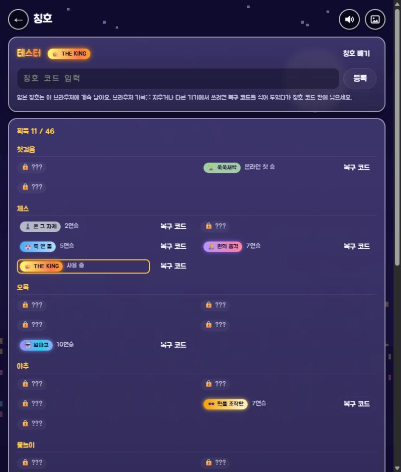
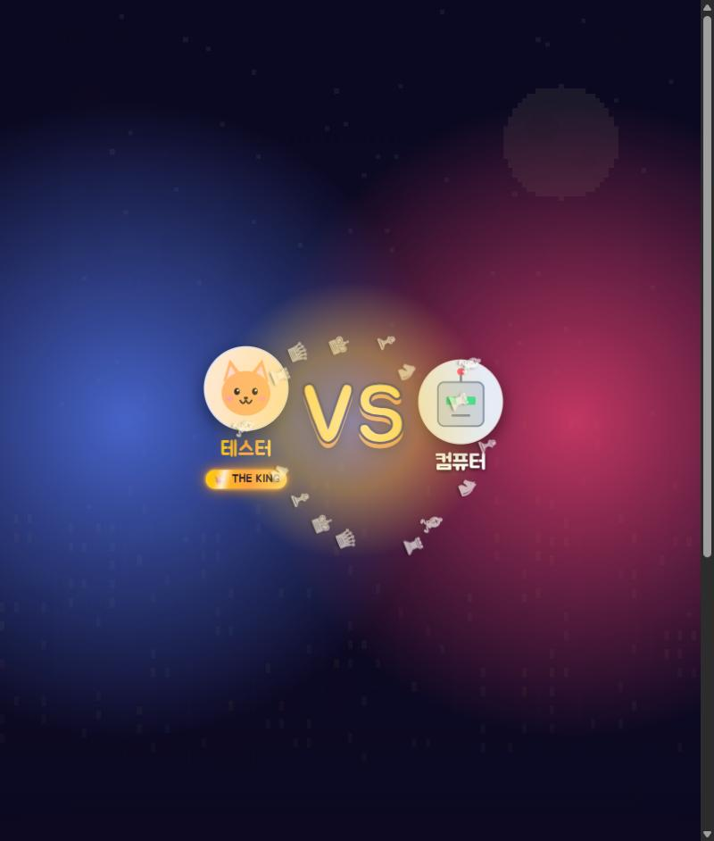
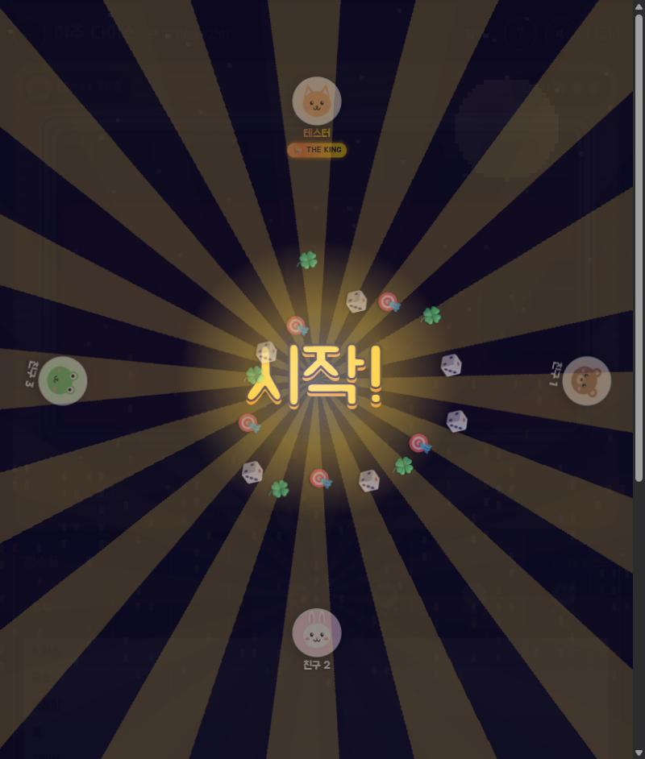
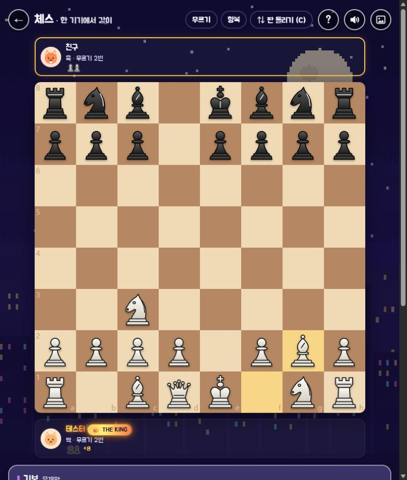
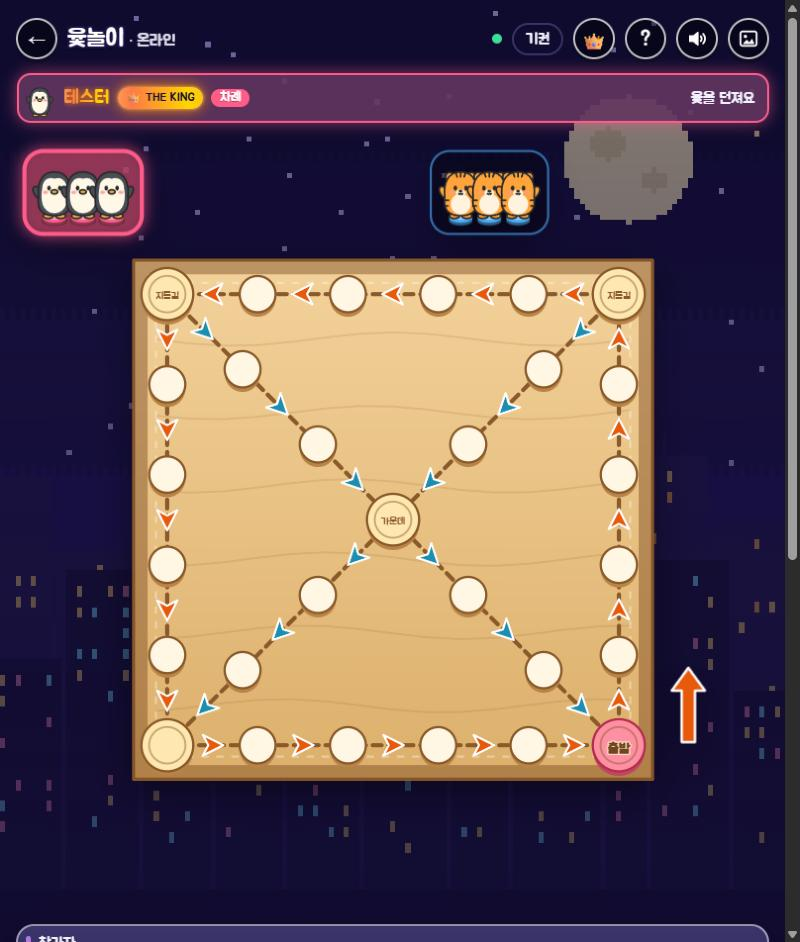
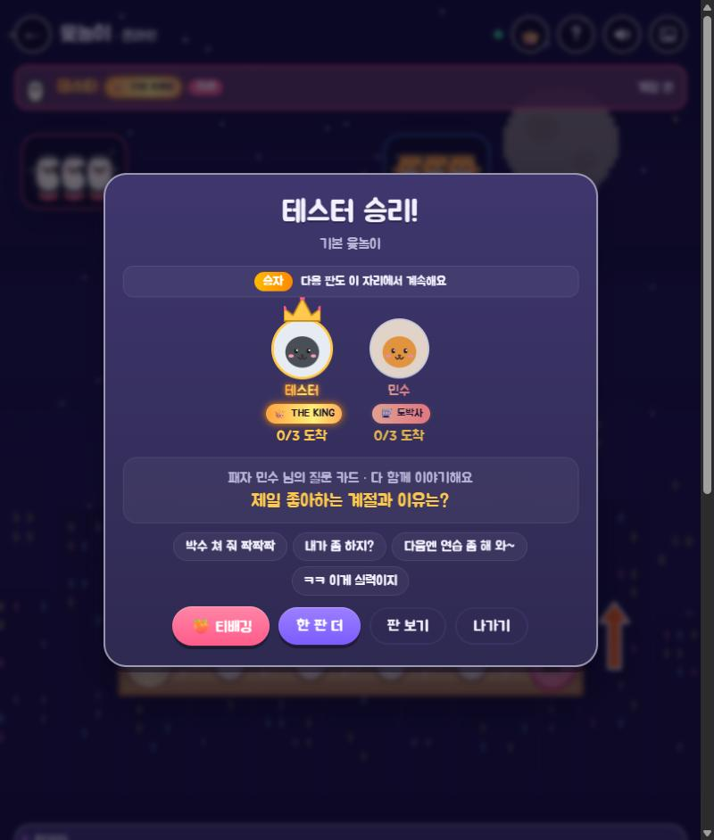

# KI득KI득 개발 기록 — 고민과 경험

> KDA 5기 송재혁 · AI 코딩 도구(Claude Code)와 대화하며 함께 만든 과정을 정리한 기록입니다.

"로컬에서 돌아가는 체스 하나"로 시작해서, 새 기수 아이스브레이킹용 LAN 게임룸이 되기까지의 흐름과
그때그때 부딪힌 문제, 고민, 배운 점을 남깁니다.

---

## 1. 출발: 체스 하나

처음 요구사항은 단순했습니다. **백/흑을 고를 수 있고, 칸이 정사각형이고, 기물이 칸 정중앙에 오는 체스.**

- 판을 그릴 때 칸 크기를 실수로 계산하면 칸마다 1px씩 크기가 달라져 줄이 삐뚤어 보였습니다.
  → 칸 크기를 **정수**로 고정(`min(w, h) // 8`)하고 남는 여백은 판 바깥으로 돌려 해결.
- 기물 디자인은 세 번 바꿨습니다. 처음 도형 기물은 "별로"라는 피드백 → 클래식 실루엣 → 다시 다른 모양.
  최종적으로 **Pillow로 크게 그린 뒤 줄여서**(슈퍼샘플링) 매끈한 기물 이미지를 만들고, 이동은 0.2초 감속 애니메이션.
- 시간 모드(무제한 / 10분 / 3분+2초 증가)를 넣으면서 "시계는 첫 수를 둔 뒤부터 돈다", "무르면 시계도 되돌린다" 같은 세부 규칙을 정했습니다.

## 2. 같은 와이파이에서 같이 하기

"다른 PC랑 하려면 뭘 줘야 하지?"에서 네트워크 대전이 시작됐습니다.

- **TCP + JSON 한 줄 메시지**: 단순하고 디버깅하기 쉬움. 포트는 체스 50007 / 야추 50008 / 오목 50009.
- 첫 버그: **IP를 입력하고 참가를 눌러도 아무 일도 없음.** 원인은 참가 창을 닫은 *뒤에* 입력칸 값을 읽으려 한 것. 창을 닫기 전에 값을 먼저 읽도록 수정.
- 통신은 별도 스레드에서 받고, 화면은 `queue`로 넘겨 tkinter 메인 스레드에서만 그리게 분리했습니다. (tkinter는 스레드에 안전하지 않음)
- 나중에 **메시지 크기 제한**(한 줄 300KB)을 넣었습니다. 프로필 사진을 주고받게 되면서, 비정상적으로 긴 메시지가 오면 연결을 끊도록.

## 3. exe 만들기 — 생각보다 큰 산

친구 PC에는 Python이 없으니 exe가 필요했습니다. 여기서 시간을 꽤 썼습니다.

| 문제 | 원인 | 해결 |
| --- | --- | --- |
| exe가 **177MB** | 개발 PC의 온갖 라이브러리가 같이 묶임 | 깨끗한 가상환경에서 빌드 → **약 21MB** |
| 창 모드 exe에서 **클릭이 안 먹음** | 콘솔이 없는 exe에서 `print`가 터지며 이벤트 처리가 끊김 + 마우스를 올리면 움직이는 도형에 `tag_bind`를 건 구조 | 출력은 임시 폴더 로그 파일로 돌리고, 클릭은 **좌표 판정 방식**(그릴 때 버튼 영역을 등록 → 마우스 좌표로 찾기)으로 전부 교체 |
| 폰트 경로 오류 | PyInstaller `--add-data`가 spec 위치 기준 상대경로 | 절대경로로 지정 |
| 실행 중인 exe를 덮어쓰기 실패 | 파일 잠김 | 교체 전에 실행 여부 확인 |

배운 점: **"내 PC에서 된다"와 "exe로 남의 PC에서 된다"는 완전히 다른 문제**다. 창 모드, 경로, 의존성은 처음부터 의식해야 한다.

## 4. 맥 지원

맥 친구도 있어서 맥용도 만들었습니다.

- 맥에서 Windows exe는 안 돌아가므로, **더블클릭으로 실행되는 `.command` 파일 + 소스**를 zip으로 묶음.
- Windows에서 만든 zip이라도 맥에서 실행 권한이 살아 있도록 zip 항목에 유닉스 권한(`external_attr`)을 직접 기록.
- 맥에서는 장난용 "방장 사기 모드"를 숨기는 옵션도 넣었습니다.

## 5. 게임이 늘어나다: 야추 다이스, 그리고 게임룸

체스만으로는 여러 명이 즐기기 어려워서 **최대 6명까지 하는 야추 다이스**를 추가했고, 자연스럽게 **게임을 고르는 첫 화면(허브)**이 필요해졌습니다.

- 닉네임 → 게임 카드 선택 → 모드 선택 → 시작, 이 흐름을 하나의 캔버스 위에서 화면 전환으로 구현.
- 야추는 "컵을 꾹 눌러 흔들다 놓으면 던진다"는 손맛을 위해 **주사위 물리**(튕김, 회전, 감속)를 직접 구현.
- 점수표 항목에 마우스를 올리면 **설명 말풍선**과 예시 주사위가 뜨게 해서, 규칙을 몰라도 바로 할 수 있게.
- 네트워크 야추는 **방장이 판정**(authoritative)하고, 참가자는 행동만 보내고 결과 상태를 받는 구조. 대기실을 만들어 누가 들어왔는지 보이게 했습니다.

## 6. 폰트: 귀엽게, 하지만 어디서나 똑같이

"좀 더 귀여운 폰트"를 원했지만, 맥/윈도우에 기본으로 깔린 귀여운 한글 폰트는 없었습니다.

- **주아체(SIL OFL, 자유 배포 가능)**를 앱에 넣고, 실행할 때 **이 프로그램 안에서만** 불러오도록 처리.
  - Windows: `AddFontResourceExW` (FR_PRIVATE)
  - Mac: CoreText `CTFontManagerRegisterFontsForURL`
- 시스템에 폰트를 설치하지 않으니 사용자 PC를 건드리지 않는 점이 좋았습니다.

## 7. 아이스브레이킹 장치들

이 프로젝트의 진짜 목적은 "게임"보다 **"말 걸 계기"**였습니다. 그래서 장난 요소를 계속 더했습니다.

- **프로필**: 동물 캐릭터 8종(직접 그림) 또는 내 사진(가운데를 동그랗게 잘라 96px로 저장, 네트워크로도 전송).
- **결과 화면**: 왕관, 승/패, 상황별 도발 멘트 버튼("운빨이잖아!!", "다음엔 연습 좀 해 와~").
- **티배깅**: 이긴 사람 프로필이 상대 머리 위로 날아가 앉았다 일어났다를 반복.
  - 나중에 "진 사람은 못 하게, 당하는 쪽이 더 열받게" 요청이 와서 → 이긴 사람만 가능, 당하는 쪽 얼굴이 빨개지고, 핏줄 💢이 뛰고, 김이 나고, 닿을 때마다 "쿵! 퍽!", 놀리는 글자("킹받쥬?", "-100 자존심")가 떠오르게 강화.
- **채팅 + 스티커**: 컬러 이모지는 OS마다 깨져서 **스티커 8종을 코드로 직접 그림**. 팝업은 화면을 가리지 않게 보낸 사람 쪽 구석에 작게.
- **누적 랭킹**: 이 PC에서 한 판들의 우승 횟수.
- **항복 버튼**: 모든 게임에.
- **관전 모드**: 대전 중인 방에 들어가면 관전자로. 관전자도 채팅/스티커 가능, 참가자 현황에 관전자 이름까지 표시.

## 8. 오목

세 번째 게임으로 오목을 추가했습니다.

- 승리 판정은 "정확히 5목"(장목 불인정) 규칙과 **쌍삼 금지 / 자유룰** 선택.
- 쌍삼 판정은 각 방향으로 "열린 3"이 되는지 검사해서 두 방향 이상이면 금지.
- 컴퓨터는 5칸 창(window) 점수 방식: 각 자리 주변 5칸 묶음마다 내 돌/상대 돌 수로 점수를 매겨 공격과 수비를 함께 고려.

## 9. 이름 짓기

처음 이름은 "미니게임룸". 기관 아이스브레이킹 용도라는 걸 살려 키움의 **K**를 넣고, 더 위트 있게 고민하다
**KI득KI득**(키득키득 + Kiwoom)으로 결정. 부제는 "같은 기수, 키득키득". (v2.3에서 처음 만난 사이라는 기획 의도가 더 잘 보이게 "처음 만난 우리, 한 판이면 친구"로 바꿈)

## 10. 화면이 예뻐야 계속 한다: UI 다듬기

기능이 다 된 뒤에는 "보기 좋아야 손이 간다"는 생각으로 UI를 여러 번 다듬었습니다.

- **배경**: 단색 → 남색·보라·자주 3색 그라데이션 + 빛 번짐 + 점무늬 + 떠다니는 게임 아이콘.
  게임 화면에도 같은 배경을 깔되, **창 전체 좌표 기준**으로 그려서 여러 캔버스가 붙어 있어도 이음매가 안 보이게.
- **둥근 UI**: tkinter 기본 위젯은 전부 네모라서, 둥근 카드(`Card`)와 알약 버튼(`RoundButton`)을 캔버스로 직접 만들어 교체.
- **깨지는 가장자리**: tkinter 도형은 안티앨리어싱이 없어서 원과 둥근 모서리가 계단처럼 보였습니다.
  → 프로필, 스티커, 카드, 결과 화면, 주사위 컵과 트레이까지 **Pillow로 2~4배 크게 그린 뒤 줄이는 방식**으로 통일.
  → 네모난 캔버스의 모서리는 **뒤 배경색을 정확히 계산한 반투명 덮개**로 둥글게.
- **화면 크기 적응**: 기준 크기(1240×820) 대비 비율 `k`를 글자·버튼·간격에 곱함.
  오른쪽 패널은 세로 공간이 모자라면 덜 중요한 것부터 줄임(기보 → 참가자 한 줄 요약 → 채팅 줄 수 → 참가자 숨김).
- **야추 테이블**: 층진 금속 테두리 트레이, 파인 주사위 칸, 빨간 펠트, 검은 가죽 컵으로 다시 그림.

## 11. 기억에 남는 버그와 고민

- **티배깅이 안 보이는 버그**: 상태는 정상인데 화면에 안 나옴. 알고 보니 매 프레임 결과 카드 전체(큰 반투명 이미지 포함)를 다시 그려서
  프레임이 너무 느렸고, 애니메이션이 거의 끝난 뒤에야 그려지고 있었음.
  → 고정된 부분과 움직이는 부분을 **레이어로 분리**해서 움직이는 것만 다시 그림.
- **카드가 글자 길이를 못 따라가는 버그**: 카드 폭을 강제로 맞추면 안쪽 내용이 커져도 이벤트가 안 와서 글자가 잘림.
  → "배치된 폭이 내용 폭과 다를 때만 강제" + 패널을 맞출 때 안쪽 카드부터 크기를 다시 계산.
- **네트워크 무르기**: "무제한 무르기는 안 된다"는 요청. 그냥 무르면 두 PC 판이 어긋날 수 있어서,
  **요청 → 상대가 아직 안 뒀는지 확인 → 수락/거절** 순서의 작은 합의 과정을 만들고 한 판에 2번으로 제한.
- **캔버스의 `lift()`**: Canvas 위젯에서 `lift()`는 위젯이 아니라 *그림*을 올리는 함수라 오류. `tk.Misc.lift`로 해결.
- **테스트 방식**: 실제 마우스로 사용자 화면을 클릭하거나 화면 전체를 캡처하는 대신,
  **내 창만 캡처(PrintWindow)**하고 **좌표 이벤트로 클릭을 흉내** 내고, 설정 파일은 별도 폴더를 쓰도록 바꿔서 실제 설정을 건드리지 않게 했습니다.
  네트워크는 한 PC에서 방장/참가자/관전자 프로세스를 동시에 띄워 확인.

## 12. 하지 않기로 한 것

- 특정 상용 보드게임을 그대로 베끼는 것은 하지 않았습니다. 대신 **누구나 아는 전통 규칙 게임**(체스, 야추, 오목)으로 구성하고,
  그림과 효과는 모두 직접 그렸습니다.
- 외부 서버 없이 **같은 와이파이 안에서만** 동작하게 해서, 계정·개인정보 걱정 없이 교실에서 바로 쓸 수 있게 했습니다.

## 13. 배운 점

1. **목적이 기능을 정한다.** "아이스브레이킹"이라는 목적이 정해지자 도발 멘트, 티배깅, 관전 채팅처럼 *대화를 만드는 기능*의 우선순위가 올라갔다.
2. **배포는 개발의 절반.** exe 크기, 창 모드 출력, 방화벽, 맥 실행 권한처럼 코드 밖의 문제가 사용자 경험을 좌우한다.
3. **작은 디테일이 인상을 바꾼다.** 계단진 원 테두리, 네모난 모서리 하나가 전체를 싸 보이게 만든다. 반대로 안티앨리어싱 하나로 확 고급스러워진다.
4. **네트워크는 "동시에"를 의심해야 한다.** 무르기처럼 단순해 보이는 기능도 두 PC가 동시에 움직이면 어긋날 수 있다.
5. **AI와 함께 만들기**: 원하는 것을 구체적으로 말할수록(참고 이미지, "이 부분이 거슬린다") 결과가 빨리 좋아졌다.
   반대로 AI가 만든 결과도 스크린샷과 자동 테스트로 직접 확인하는 습관이 중요했다.

---

## 14. v1.1 — "여러 팀이 동시에 쓰는 교실"을 위한 업데이트

첫 공개 뒤 "체스 2팀, 야추 3팀, 오목 5팀이 동시에 해도 괜찮을까?"라는 질문에서 출발했습니다.
구조상 방장 PC마다 별개의 방이라 문제는 없었지만, **IP를 잘못 입력하면 남의 방에 관전자로 들어가는** 불편이 보였습니다.
그래서 개선할 점을 우선순위로 정리하고 하나씩 구현했습니다.

### 넣은 것

| 기능 | 고민 | 구현 |
| --- | --- | --- |
| **열린 방 자동 검색** | 10팀이 IP를 주고받는 건 번거롭고 실수가 잦다 | 방장 PC가 1초마다 UDP 방송으로 "여기 방 있어요"를 알리고, 참가 화면에서 목록으로 보여 줌. 대전 중인 방을 누르면 자동으로 관전 선택 |
| **재접속** | 와이파이가 잠깐 끊기면 판이 날아감 | 참가자는 30초 동안 2초마다 다시 접속. 방장은 같은 이름이 돌아오면 지금까지의 수 · 시계 · 무르기 횟수를 보내 판을 이어 줌. 야추는 끊긴 동안 컴퓨터가 대신 두다가 자리를 돌려줌 |
| **우리 반 랭킹** | PC마다 따로 기록돼서 반 전체 순위를 볼 수 없음 | 각 PC가 **자기 닉네임의 기록만** 방송 → 같은 판이 두 번 세지지 않음. 서버 없이 켜 둔 친구들끼리 모아서 보여 줌 |
| **한 줄 소개** | 게임 전에 말 걸 거리가 필요함 | 첫 화면에 MBTI · 관심사 입력칸. 같은 방송으로 퍼져서 참가자 목록에 이름과 함께 표시 |
| **진 사람 질문 카드** | 게임이 대화로 이어지게 하고 싶음 | 결과 화면에 "최애 점심 메뉴는?" 같은 가벼운 질문. 두 PC에서 **같은 질문**이 나오도록 이름과 수 개수로 정해지게(crc32) 함 |
| **효과음** | 소리 파일을 넣으면 용량과 라이선스가 신경 쓰임 | 사인파 · 잡음을 조합해 **코드로 wav를 만들어** 재생 (Windows winsound, 맥 afplay). 첫 화면에서 끌 수 있음 |
| **컴퓨터 난이도** | 체스/오목을 처음 하는 동기도 이길 수 있어야 함 | 체스는 탐색 깊이(1/2/3수)와 실수 확률, 오목은 점수에 섞는 무작위 크기, 야추는 기록 · 고정 실수 확률로 조절 |
| **규칙 보기** | 규칙을 몰라서 못 끼는 사람이 없게 | 메뉴에 게임별 규칙 화면 |
| **자동 테스트** | 기능이 늘수록 손으로 확인하기 어려움 | `tests/`에 규칙 엔진 · 질문 카드 · 방송 메시지 · 효과음 테스트 13개. 체스는 perft(시작 위치 3수까지 8902가지)로 검증 |
| **새 버전 알림** | 교실 PC마다 옛 버전이 남아 있을 수 있음 | 저장소의 `VERSION` 파일과 비교해서 새 버전이면 첫 화면에 '새 버전 받기' 버튼 |

### 하지 않기로 한 것

- **채팅 욕설 필터**: 넣으려다 뺐습니다. 동기들끼리의 자연스러운 대화를 막지 않는 쪽을 택했습니다.
- **대화형 새 게임(빙고)**: 만들기 시작했다가 방향이 맞지 않아 접었습니다. 지금은 체스 · 야추 · 오목 세 가지에 집중합니다.
- **큰 리팩터링**: 체스와 오목은 네트워크 · 결과 화면 코드가 비슷하지만, 이미 공통 부분(`ui_kit`, `party`, `lan`, `sound`)을 모듈로 뺐고
  남은 부분을 억지로 합치면 버그 위험이 더 크다고 판단해 **테스트를 먼저 갖추는 것**으로 대신했습니다.
- **GitHub Releases 자동 업로드**: 토큰이 필요한 작업이라 자동화하지 않고, exe는 `release/` 폴더에 두고 앱은 `VERSION` 파일로 새 버전을 확인합니다.

### 배운 점

- **"동시에" 쓰는 상황을 상상하면 필요한 기능이 보인다.** 혼자 테스트할 때는 IP 입력이 불편하지 않았지만, 열 팀이 쓰는 교실을 떠올리자 자동 검색이 1순위가 됐다.
- **서버 없이도 모을 수 있다.** 각자 "내 기록"만 방송하는 규칙 하나로 중복 없이 반 전체 랭킹을 만들 수 있었다.
- **두 PC가 같은 결과를 내야 하는 곳**(질문 카드, 무르기, 재접속)은 무작위 대신 양쪽이 같은 재료로 계산하거나, 한쪽(방장)이 정한 값을 보내는 방식이 안전하다.
- **사용자의 "빼자"도 중요한 결정이다.** 다 만들 수 있다고 다 넣는 게 아니라, 목적(아이스브레이킹)에 맞는지로 걸러야 한다.

---

## 15. v2.0 — 웹 · 모바일판

"폰으로도, 다른 와이파이에서도 같이 하고 싶다"는 요청에서 출발했습니다. tkinter 창은 브라우저와 폰에서 돌아가지 않아서 화면을 웹으로 새로 만들었습니다.

| 고민 | 결정 |
| --- | --- |
| 다른 와이파이 · 폰끼리 어떻게 잇나 | 데스크톱판의 '방장 PC' 역할을 **인터넷 서버**가 대신. 파이썬(aiohttp) 웹소켓 서버 하나가 화면도 보내고 방도 관리 |
| 규칙을 어디서 계산하나 | 서버는 "누가 어떤 순서로 무엇을 했는지"만 정해 모두에게 보내고(순서 번호 + 서버 시각), **모든 브라우저가 같은 규칙으로 똑같이 계산**. 주사위 눈은 굴린 사람이 정해서 같이 보냄 |
| 체스 시계가 기기마다 다르면? | 각자 자기 시계를 쓰지 않고 **서버가 붙인 시각**으로 남은 시간을 계산. 시간 초과도 서버 시각으로 확인 |
| 재접속 · 늦게 온 관전자 | 서버가 이번 판의 수 기록을 들고 있다가 다시 들어오면 처음부터 다시 계산(replay) |
| 규칙 엔진 옮기기 | 파이썬 엔진을 자바스크립트로 한 줄씩 옮기고, 같은 테스트(perft 8902 · 쌍삼 · 야추 점수 · 질문 카드 crc32)로 결과가 같은지 확인 |
| 그림 | Pillow로 그리던 동물 · 스티커 · 기물을 SVG로 옮김. tk의 곡선 방식(2차 B-스플라인)을 그대로 따라 해서 모양이 같게 |
| 폰 조작 | 15×15 오목판은 손가락이 커서 잘못 누르기 쉬움 → **한 번 누르면 미리 보기, 한 번 더 누르면 놓기**. 야추 컵은 꾹 누르는 동안 흔들리고 놓으면 던짐 |
| 친구 초대 | IP 대신 **4자리 방 코드 + 링크**. 폰에서는 공유 버튼으로 바로 단톡방에 보냄 |
| 배포 | Render 무료 플랜 + `render.yaml`. 잠들어 있으면 첫 접속이 느린 대신 비용이 없음 |

### 배운 점

- **"누가 판정하나"를 먼저 정하면 나머지가 쉬워진다.** 서버는 순서와 시각만, 규칙은 모든 기기가 같이 — 이 한 줄이 무르기 · 시계 · 재접속을 모두 단순하게 만들었다.
- **같은 테스트를 두 언어에 돌리면 옮긴 코드를 믿을 수 있다.**
- **뒤에 있는 탭은 애니메이션이 멈춘다.** 티배깅 정리를 그림 프레임에만 맡겼다가 남은 그림이 생겨서, 시간이 되면 반드시 정리하도록 바꿨다.

---

## 16. v2.1 — 손맛 되살리기, 한 화면, 그리고 교실에서 오래 쓰기

웹판을 띄워 보니 "야추가 슴슴해졌다", "점수표 보려고 스크롤하는 게 불편하다"는 피드백이 나왔습니다.

| 고민 | 결정 |
| --- | --- |
| 야추 손맛 | 데스크톱판의 컵 · 트레이 · 주사위 물리(튕김 · 회전 · 서로 부딪힘)를 캔버스로 옮김. 꾹 눌러 흔들고 놓으면 던지기, 스페이스바도 같게 |
| 한 화면에 보이기 | 야추는 트레이 왼쪽 · 점수표 오른쪽 · 채팅 왼쪽 아래. 체스 · 오목도 무르기 · 항복을 상단바로 올리고 판 크기를 화면 높이에 맞춤 |
| 점수 고르기 | 주사위가 멈추면 추천 칸 3개를 버튼으로. 컴퓨터와 같은 기준이되, 점수가 나는 칸을 먼저 추천 |
| 랭킹이 사라짐 | 무료 서버는 다시 켜질 때 파일이 지워짐 → Supabase에 저장(없으면 파일). 서비스 키는 서버 환경 변수에만 |
| 랭킹 장난 | 결과는 방장이 보내지만, 서버가 판 시작 때 앉아 있던 이름만 받음 |
| 주사위 조작 | 굴린 사람 대신 서버가 눈을 정함 |
| 끊긴 친구 | 야추는 6초 뒤 방장 기기의 컴퓨터가 대신 둠. 서버는 "방장이고, 그 사람이 정말 끊겼을 때만" 허락 |
| 사람이 많을 때 | 대기 줄 + 연승. 진 사람은 줄 맨 뒤로, 이긴 사람은 계속. 방장이 져서 줄로 가도 다음 판은 시작할 수 있게 |
| 모르는 사람 | 비공개 방 (목록에 안 보이고 코드로만) |
| 도배 | 접속마다 5초에 메시지 60개, 채팅 · 효과 8개까지 |
| 자동 테스트 | 파이썬 25개 + 자바스크립트 10개, GitHub Actions로 push마다 |

### 배운 점

- **"뒤에 있는 탭"은 생각보다 자주 생긴다.** 그림 프레임이 멈추면 주사위가 영원히 굴러가는 버그가 났고, 크기 알림까지 오지 않아 물리가 아예 시작되지 않았다. 시간이 되면 반드시 멈추게 하는 안전장치가 필요했다.
- **서버를 믿고 클라이언트를 의심하기.** 결과 이름, 주사위, "대신 두기" 모두 서버가 마지막에 확인하게 바꾸니 장난칠 구멍이 줄었다.
- **배포하면 캐시가 발목을 잡는다.** 새 화면을 올려도 브라우저가 옛 파일을 쓰지 않도록 `no-cache`를 붙였다.

---

## 17. v2.2 — 보안 · 비용 점검, 테마, 시작 화면

실제로 반 친구들에게 주소를 돌리기 전에 "해킹이나 과금 걱정은 없나?"를 먼저 점검했습니다.

### 점검에서 찾은 것

| 구분 | 문제 | 고친 방법 |
| --- | --- | --- |
| 보안 (높음) | 브라우저 비밀 열쇠(cid)가 방 사람 모두에게 보여서, 그 값으로 접속하면 남의 자리 · 방장 자리를 가로챌 수 있었음 | 비밀 열쇠는 본인만, 다른 사람에게는 서버가 만든 공개 번호(pid)만 |
| 보안 | 게임 수 · 효과 메시지 크기 제한이 없어 방 하나에 수백 MB를 쌓을 수 있었음 | 수는 2KB까지, 효과는 정해진 종류와 칸만 |
| 보안 | 판에 앉는 사람 목록(이름 · 사진)을 방장 브라우저가 만들어 바꿔치기 가능, 사진 6장이면 메시지 크기를 넘어 시작이 안 될 수도 | 서버가 직접 만들고 방장은 자리 순서만 보냄 |
| 보안 | 접속 수 · 방 수 제한 없음 | 주소당 60개(학교 와이파이 고려), 서버 전체 상한 |
| 보안 | 보안 헤더 없음, 다른 사이트에서 웹소켓 연결 가능 | CSP · 클릭재킹 차단 · Origin 확인 |
| 비용 | 방 정보가 바뀔 때마다 모두의 프로필 사진(최대 360KB)을 다시 보냄 | 사진은 들어올 때 한 번만, 브라우저가 기억 |
| 비용 | 탭을 열어 두면 연결이 계속 살아 있어 무료 서버가 잠들지 못하고 한 달 시간을 다 쓸 수 있음 | 오래 아무것도 안 한 연결은 서버가 끊고, 다시 화면을 누르면 자동으로 이어 붙임 |

Supabase(행 단위 보안 + 함수 권한 회수 + 키는 서버 환경 변수에만)와 화면 출력(모든 이름 · 채팅을 글자로만)은 문제없었습니다.

### 넣은 것

- **QR 크게 보기**: 교실 빔프로젝터에 띄우고 폰 카메라로 찍어 바로 입장 (서버가 우리 방 링크만 QR로 만듦)
- **내보내기**: 방장이 내보낸 사람은 같은 방에 다시 못 들어옴
- **끊김 카운트다운**: 체스 · 오목에서 상대가 끊기면 "N초 안에 안 오면 기권"
- **테마 3종**: 밤하늘 · 말랑말랑(파스텔, 물방울 무늬, 통통한 버튼) · 오락실(네온, 격자 바닥). 색을 전부 변수로 바꿔 테마마다 값만 갈아 끼움
- **시작 화면**: 왼쪽 '플레이어 카드'와 오른쪽 게임 타일의 높이를 맞추고, 로고가 통통 튀고 아이콘이 둥실 떠 있는 게임 시작 화면처럼. 폰은 게임 고르기가 먼저 보이게
- 데스크톱판에 **웹판** 버튼, `render.yaml`에 Supabase 키 이름(`sync: false`)

### 배운 점

- **"보여도 되는 값"과 "비밀인 값"을 처음부터 나눠야 한다.** 편하게 쓰던 ID 하나가 자리 가로채기의 열쇠였다.
- **무료 서버의 비용은 돈이 아니라 시간이다.** 열어 둔 탭 하나가 한 달 무료 시간을 다 쓸 수 있다는 걸 점검하면서 알았다.
- **테마는 색을 변수로 모아 두면 쉽다.** 처음에 곳곳에 박아 둔 색을 찾아 변수로 바꾸는 게 테마를 만드는 일의 대부분이었다.

## 18. v2.3 — 능력 카드 윷놀이

네 번째 게임은 모두가 규칙을 아는 윷놀이에, 요즘 밈을 이름으로 단 능력 카드를 섞었습니다. "대화는 채팅으로 하니까 능력에만 집중", "좀 더 막장으로"라는 의견을 따라 대화형 능력은 빼고 판을 뒤집는 능력을 늘렸습니다.

### 만든 방식

- **규칙 엔진과 카드 목록을 나눔**: `engine/yut.js`는 판 · 이동 · 잡기 · 능력 효과만, `data/yut_abilities.js`는 이름 · 대사 · 확률만. 유행어는 금방 바뀌니까 다음 기수가 목록 파일만 고치면 된다
- **확률은 무게로**: 카드마다 모드별 무게를 적고, 확률 = 무게 / 전체 무게. 게임 화면의 확률표가 같은 계산으로 %를 보여 줘서 "왜 나만 안 나와?"에 바로 답할 수 있다
- **카드는 시작할 때만**: 처음엔 ★ 칸에 멈출 때마다 카드를 줬는데, 판이 카드 칸 투성이가 되고 운이 너무 갈렸다. 시작할 때 모두 같은 장수(특수능력 3 · 막장 4)를 받아 아껴 쓰는 쪽이 작전 짜는 재미가 있다
- **판을 보기 쉽게**: 위에서 본 납작한 판 대신 위에서 내려다본 정사각형 판(처음엔 45도 돌린 마름모, 다음엔 비스듬히 본 사각형이었는데 윷판은 위에서 본 정사각형이 가장 익숙해서 이렇게 정함), 서 있는 동물 캐릭터 말, 가는 방향 화살표(바깥 길 빨강 · 지름길 파랑), '출발 · 골인' 팻말. 말을 누르면 갈 칸에 말풍선이 떠서 "어떤 결과로 어디까지 가는지"를 눌러 보기 전에 안다. 말풍선끼리 겹치면 위로 비켜 쌓고, 아래 결과 버튼으로도 옮길 수 있게 해서 잘못 누르는 일을 줄임
- **2:2 팀전**: 4명이면 A · B팀 2명씩 (한 기기는 시작 창, 온라인은 대기실에서 방장이 나눔, 앉는 순서는 팀이 번갈아 던지게 자동으로). 같은 팀 말은 업혀 다니고 서로 안 잡으며, 내 말이 다 들어오면 같은 팀 말을 옮김. 한 명이 기권하면 그 팀이 짐
- **시작할 때 말 고르기**: 모두 캐릭터를 고른 뒤 첫 윷을 던짐. 먼저 고른 사람의 캐릭터는 다른 사람이 못 고름 (온라인에서 동시에 같은 걸 고르면 먼저 도착한 쪽)
- **윷은 판 위로 던짐**: 아래 작은 칸이 아니라 판 위로 윷가락 4개가 날아와 나란히 서고(평평한 면은 밝은 나무, 둥근 등은 × 무늬), 옆에 "개 / 2칸 앞으로"처럼 결과를 적음
- **진짜 윷 소리**: 코드로 만든 딱딱 소리는 윷 같지 않다는 의견에, 출처를 밝힌 무료 효과음 영상의 소리 5개를 잘라 무작위로 틀고 출처는 '정보' 창과 README에 적음 (파일을 못 불러오면 코드로 만든 소리로)
- **모든 무작위는 서버가 정한 seed로**: 윷 결과, 카드 뽑기, 대환장 파티 섞기, 동전 던지기까지 행동마다 서버가 붙인 seed로 계산한다. 그래서 모든 기기가 같은 판을 보고, 다시 들어와도 기록만 다시 돌리면 같은 판이 된다 (야추 주사위를 서버가 굴리게 바꾼 것과 같은 이유)
- **컴퓨터 대전은 뺌**: 능력 카드 판단까지 넣으면 일이 커지고, 이 게임은 사람끼리 떠드는 재미가 핵심이라서

### 배운 점

- **"아무렇게나 끝까지 둬 보기" 테스트가 제일 많이 잡는다.** 카드 18종이 서로 얽히는 경우를 손으로 다 짤 수는 없어서, seed를 고정하고 4명이 무작위로 끝까지 두게 한 뒤 규칙이 안 깨지는지, 같은 seed면 같은 판인지를 본다.
- **밈은 사람을 겨냥하지 않는 것만 고른다.** 유명인 · 방송 이름이나 누군가를 깎아내리는 밈은 빼고, 상황을 웃기게 만드는 말만 썼다.

---

## 19. v2.4 — 대기실부터 결과까지, 함께 친해지는 흐름 다듬기

온라인에서 실제로 방을 만들고 친구를 초대해 보니, 기능이 있어도 클릭이 먹지 않거나 다음 화면으로 넘어간 뒤에야 설정하는 등 흐름이 끊기는 순간이 있었습니다. 게임 규칙뿐 아니라 **방에 들어와 함께 준비하고, 플레이하고, 대화를 이어 가는 과정 전체**를 다시 살펴봤습니다.

### 대기실과 이동 흐름

| 고민 | 해결 |
| --- | --- |
| 방장이 캐릭터를 고르려는데 버튼을 눌러도 말이 바뀌지 않음 | 온라인 대기실의 선택 입력과 상태 갱신 경로를 점검해 선택 결과가 화면과 방 상태에 바로 반영되도록 수정. 방장도 친구를 기다리는 동안 말과 팀을 미리 정할 수 있게 함 |
| 게임 시작 전에 말 선택을 요구하거나, 시작 후 다시 캐릭터를 고름 | 방 생성 → 별도 대기실에서 팀 · 이름 · 말 준비 → 시작 순서로 정리. 말 선택이 끝나지 않은 상태에서는 시작할 수 없고, 게임 시작 뒤의 중복 말 선택 절차는 제거 |
| 캐릭터 8종이 한 줄에 어긋나고 '선택 안 함'과 랜덤이 헷갈림 | 4×2 선택판으로 정렬하고, 선택 안 함은 기본 상태로 테두리 표시. 랜덤은 별도 버튼으로 분리해 의미를 구분 |
| 팀을 옮길 때 버튼이 작고 어느 팀인지 바로 안 보임 | 4명일 때 팀전을 선택하고, 대기실에서 드래그로 A · B팀을 옮기며 인원수를 확인. 플레이어 이름도 대기실에서 바꿀 수 있게 함 |
| 뒤로 가기 · Esc가 화면마다 다른 곳으로 가거나 설정 창을 엶 | 메인 메뉴 · 방 목록 · 대기실 · 게임 화면의 이동을 정리하고, 나가기 확인이 필요한 게임 안에서는 Esc로 확인 창을 열도록 맞춤. Enter는 화면의 기본 진행 동작과 연결 |
| 카드 추첨이 너무 빠르거나 화면을 넘어 스크롤해야 함 | 시작 전 별도 화면에서 카드가 순차적으로 멈추는 추첨 연출로 바꾸고 효과음을 추가. Esc로 건너뛸 수 있다는 안내도 화면에 표시 |

### 윷놀이 화면과 규칙

- **한 화면에서 판을 먼저 읽기**: 윷판은 왼쪽에서 크게 보이고, 진행 정보 · 채팅 · 카드 관련 UI는 오른쪽으로 정리. 차례 표시를 더 눈에 띄게 하고, 채팅 스티커와 입력칸은 화면을 밀어내지 않도록 비율 조정.
- **플레이어 카드 중복 줄이기**: 카드에는 이름을 오른쪽에 크게 표시하고, 골인한 말은 회색으로 처리. 도착/남은 말 수처럼 이미 다른 곳에 보이는 정보는 반복하지 않도록 정리.
- **2인 자리 배치**: 2명으로 시작하면 아래쪽부터가 아니라 지정된 위쪽 자리부터 참가자를 배치.
- **던지기와 이동 결과를 분리**: 윷을 누른 즉시 결과 말풍선이나 이동 경로를 보여 주지 않고, 던지는 연출이 끝난 뒤 결과를 공개. 말 이동도 경로 미리 보기 상태와 실제 이동을 구분해, 이동이 끝난 뒤 다음 상태를 보여 줌. 새 말은 카드에서 출발점으로 순간 이동했다가 움직이는 대신 카드에서 사라져 출발점부터 이동.
- **윷가락 연출**: 단순 회전 대신 네 가락에 서로 다른 속도와 방향을 주고, 공중 이동 · 바닥 반동 · 감속 · 정지 자세를 프레임 애니메이션으로 표현. 이미지 형태는 뾰족한 막대보다 둥근 바게트형 나무 윷에 가깝게 다듬고, 나무색과 표면 질감을 조정. 애니메이션은 길이를 줄이고 결과가 확정된 뒤에만 규칙을 진행.
- **도와 빽도**: 빽도는 실제 뒤쪽 경로로 이동. 도·빽도로 출발점까지 돌아오면 골인으로 인정하지만, 특수 능력의 강제 후퇴는 골인이 아님. 후퇴 도중 상대 말이 있는 칸을 통과하거나 도착하면 잡기 규칙을 적용.
- **특수 능력과 폭탄**: 카드를 썼을 때 즉시 효과인지 다음 차례 효과인지 일관되게 처리하고, 설치형 폭탄은 상대 말이 지나갈 때 발동하도록 확인. 스불재 폭탄은 출발점이나 말이 이미 있는 칸에 설치하지 못하게 제한.
- **윷 확률**: 결과를 무작위 가중치로 정하고 확률표에도 같은 비율을 보여 줌(도 22% · 개 32% · 걸 22% · 윷 8% · 모 8% · 빽도 8%).
- **판의 빈 공간과 출발 표시**: 판 가장자리의 비어 보이는 공간을 주변 배경과 연결하고, 별도의 출발·골인 박스는 빼서 출발 위치에 '출발'만 표시.

### 대화가 이어지도록

- 결과 화면의 질문은 벌칙처럼 답 하나를 요구하는 대신, 모두가 서로 질문하고 답할 수 있는 **대화 카드**로 정리. MBTI · 취미 · 관심사뿐 아니라 여행 취향, 첫인상, 친해지는 방식, 최근 고마웠던 일 등 처음 만난 사이도 답하기 쉬운 질문을 보강.
- 질문 선택 목록을 웹과 데스크톱에서 일치시켜 같은 온라인 판의 모든 참가자가 동일한 질문을 보게 함.
- 같은 문장을 한두 번 보내는 자연스러운 채팅은 허용하고, 짧은 시간에 같은 내용을 과도하게 반복하는 도배는 제한.
- 티배깅에서는 승리 프로필과 왕관을 한 덩어리로 움직이고, 날아가는 곡선 · 착지 반동 · 대상 흔들림 · 짧은 타격 문구를 더해 동작과 멘트를 강화.
- 첫 화면은 게임 시작 · 방 목록 · 기록 · 게임 기획 의도 네 항목으로 간결하게 정리하고, 기획 의도에는 함께 웃는 것뿐 아니라 패자의 질문 카드로 서로를 알아가며 낯선 사이의 어색함을 깨고 빨리 친해지는 목적을 명시.
- README의 오래된 첫 화면 · 대기실 · 결과 이미지를 로컬 앱 최신 화면으로 다시 캡처하고, 세 가지 테마별 타이틀과 게임 선택 화면도 교체.

### 이 과정에서 배운 점

- **입력 버튼은 상태 변화까지 확인해야 끝난다.** 클릭 이벤트가 있어도 화면과 서버 상태가 갱신되지 않으면 사용자는 기능이 고장 났다고 느낀다. 온라인 방장 화면은 직접 클릭해 바뀌는 상태를 확인해야 했다.
- **애니메이션 중에는 결과를 숨겨야 긴장감이 산다.** 결과를 먼저 노출하면 실제로 던져도 이미 답을 본 느낌이 된다. 게임 상태 적용과 시각 효과의 완료 시점을 분리했다.
- **아이스브레이킹은 질문의 난이도가 중요하다.** 너무 사적인 질문보다 취향·요즘 관심사처럼 짧게 답할 수 있는 질문이 새로운 사람 사이의 대화를 더 쉽게 연다.
- **좋은 화면 배치는 정보를 더하는 게 아니라 우선순위를 정하는 일이다.** 차례와 윷판을 먼저 읽고, 채팅과 카드 정보는 옆에서 보조하도록 배치했다.

---

## 20. v2.5 — 칭호, 시작 연출, 그리고 다시 하고 싶어지는 한 판

v2.4가 "방에 모여 끝까지 함께 노는 흐름"이었다면, 이번에는 **이기고 나서 자랑할 거리와 다음 판을 하고 싶은 이유**를 만들었습니다. 계정이 없는 게임에 영구 칭호를 넣는 방법, 화려함과 산만함 사이의 균형, 그리고 공개 저장소에 비밀 코드가 새지 않게 하는 일이 이번 작업의 큰 고민이었습니다.

### 칭호: 계정 없이 영구 소장

| 고민 | 해결 |
| --- | --- |
| 칭호 이름만 보내면 누구나 DEV를 달 수 있음 | 코드는 서버에 해시로만 두고, 서버가 '이 사람 + 이 칭호' 표를 서명해 줌. 서명이 맞아야 방 사람들에게 보임 |
| 계정이 없으면 기록을 지울 때 칭호도 사라짐 | 칭호는 브라우저에 남기고, 서버가 서명한 복구 코드로 다른 기기에 옮길 수 있게 함 |
| 처음엔 "체스 3연승"처럼 밋밋했음 | 쑥쑥새싹 · 폰 그 자체 · THE KING · 한수요 · 알파고 · D1C3 · 도박사처럼 재치 있는 이름으로. 윷놀이는 도 · 개 · 걸 · 윷 · 모에 맞춘 동물과 말장난으로 단계를 나눔 |
| 얻기 쉬운 칭호와 어려운 칭호가 똑같이 화려함 | 다섯 단계로 나눔. 1 · 2단계는 멈춘 차분한 색, 3단계부터 천천히 반짝이고, 5단계(10연승)는 불꽃 · 우주색에 빛과 광택 |
| 목록이 조건표처럼 다 보이면 모으는 재미가 없음 | 얻기 전에는 이름 · 조건을 모두 `🔒 ???`로 숨기고 `획득 N / 46`만 보여 줌 |
| 칭호가 늘어 프로필 칸이 복잡해짐 | 전용 화면으로 분리. 첫 화면 메뉴는 네 개를 유지하고, 게임 고르기 화면의 버튼으로만 들어감 |
| 이겨야만 받으면 못하는 사람은 재미가 없음 | 관전 · 무승부 · 연패 칭호와 "숨은 재미" 칭호를 추가. 서버가 볼 수 없는 조건(버튼 누르기 등)은 브라우저가 세어 신청하고, 흉내 낼 수 있으므로 정해진 재미용 칭호만 받음. DEV와 승리 칭호는 신청할 수 없음 |
| 조건이 지나치게 어렵거나 재미없음 | 새벽 2~5시 승리는 밤 11시~오전 6시로 넓히고, 티배깅 10번은 승리 후 3판으로 바꿈(한 판에 여러 번 해도 한 번만 셈) |
| 연패 칭호가 저절로 달리면 곤란함 | 이겨서 받은 칭호는 직접 골라서 닮. 코드로 받은 칭호만 바로 달림 |
| 얻은 순간이 잘 안 느껴짐 | 위에서 살짝 내려오는 획득 알림을 추가. 한 번에 여러 개를 얻으면 하나씩 차례로 보여 줌 |

같은 방의 같은 닉네임과 운영자처럼 보이는 닉네임도 막았습니다. 결과 · 연승이 이름으로 묶이기 때문입니다.

### 대기방이 번쩍여도, 안 움직여도 문제

칭호 효과는 이번에 가장 여러 번 고친 부분입니다. 처음에는 모두 계속 움직이게 했더니 "한 번에 여러 개가 번쩍여서 보기 안 좋다"는 의견이 나왔습니다. 그래서 효과를 멈췄더니 "효과가 작동 안 한다"는 의견이 이어졌고, 칭호만 움직이게 했더니 "이름도 같이 움직여야 한다"고 했습니다.

- **원인 하나**: 방 정보가 올 때마다 화면을 다시 그려서 애니메이션이 처음부터 다시 시작되거나 끊김
- **원인 둘**: 온라인 대기실만 고치고 한 기기 대기실과 윷놀이 차례 상자에는 칭호 표시가 빠져 있었음
- **해결**: 대기방에서는 평소에 멈춰 두고 3단계 이상 칭호가 **한 명씩 돌아가며** 이름과 함께 빛남. 다시 그려도 바로 이어지고, 게임 중 차례 상자와 자리 카드는 내용이 같으면 다시 그리지 않음

### 시작 연출: 다양하게, 그러나 판을 막지 않게

<table>
  <tr>
    <td width="50%"></td>
    <td width="50%"></td>
  </tr>
  <tr>
    <td align="center">1:1 · 2:2 팀전은 격돌</td>
    <td align="center">3명 이상은 모였다가 펑</td>
  </tr>
</table>

- **조합으로 다양하게**: 격돌 모션 10가지와 모이는 모션 5가지에 배경 몇 가지와 게임별 조각(기물 · 돌 · 주사위 · 윷 동물)을 섞고, 바로 전과 같은 모션과 배경은 연달아 나오지 않게 함
- **칭호를 무대에**: 칭호가 붙은 이름과 프로필이 연출의 주인공. 윷놀이는 고른 말 캐릭터가 나옴
- **순서 지키기**: 2초 동안 보여 주되 누르는 것은 막지 않아 판과 시계에 영향이 없음. 윷놀이 카드 뽑기와 차례 알림은 연출이 끝난 뒤에 시작
- **움직임을 줄인 설정** (`prefers-reduced-motion`) 을 켠 사람에게는 연출을 건너뜀

### 게임을 더 공정하고 읽기 쉽게

<table>
  <tr>
    <td width="50%"></td>
    <td width="50%"></td>
  </tr>
  <tr>
    <td align="center">체스 잡은 기물과 점수 차이</td>
    <td align="center">윷놀이 차례 상자의 이름과 칭호</td>
  </tr>
</table>

- **컴퓨터 난이도**: 쉬움 · 보통은 일부러 실수하게, 어려움은 시간 안에 깊이를 늘려 찾음. 계산은 워커에서 해서 화면이 멈추지 않음. 서로 대결시켜 보니 체스는 보통이 쉬움에 16:0, 어려움이 보통에 8:0, 오목은 15:1과 8:0. 단계 차이는 확인했지만 점수(300 · 700 · 1600)는 목표치이고 실제 레이팅으로 잰 값은 아님
- **체스 잡은 기물**: 기록을 따로 두지 않고 판에서 계산해서 무르기 · 다시 들어오기에도 그대로 맞음. 승급한 폰은 잡힌 기물로 세지 않음. 점수는 앞서는 쪽에만 `+8`처럼 보이고 같으면 비움
- **윷놀이 결과 버튼**: 예전에는 말이 골라져 있을 때만 눌렸음. 옮길 말이 하나면 저절로 골라지니 "어떨 때만 되는" 것처럼 보였음. 이제 항상 누를 수 있고, 말이 여럿이면 강조된 상태로 말을 누를 때까지 기다림
- **게임 중 Esc**: 나갈지만 묻던 창을 항복 창으로 바꿈. 계속하기 · 항복 중에 고르고, 항복하면 결과 화면에서 나갈 수 있음. Esc를 한 번 더 누르면 계속함
- **윷 · 모 뒤 먼저 이동**: 더 던지기 전에 나온 결과로 말을 먼저 옮길 수 있음
- **연타 막기**: 야추는 던진 뒤 답이 오기 전 · 굴러가는 중 · 멈춘 직후에 다시 못 던지게 함 (온라인은 답이 오기 전 틈으로 두 번 던져졌음)
- **보이는 순서 지키기**: 윷가락이 멈춘 뒤 결과를 볼 시간을 두고(윷 · 모는 더 길게), 차례가 넘어가면 판 위에 알림을 띄움. 판 바로 위에 "누구 차례 · 지금 할 일"을 모음
- **1:1 결과 흐름**: 내 역할(승자 · 패자 · 대기 · 관전자)과 다음에 무슨 일이 일어나는지를 한 줄로 보여 주고, 연승 횟수를 표시. 버튼은 티배깅 / 한 판 더 / 판 보기 / 나가기 한 줄로 정리
- **티배깅**: 버튼을 동작별로 나누지 않고 하나를 누르면 여러 모션 중 하나가 나옴. 다인전은 한 명만 고르지 않고 진 사람 모두를 차례로 공격하며(모션도 돌아가며 바뀜), 2:2 팀전도 이긴 쪽이 할 수 있음. 짓이기기보다 통통 튀며 밟는 쪽이 더 재밌다는 의견을 따름

### 올리기 직전에 잡은 일

- **테스트 파일 속 진짜 코드**: 비공개 코드 목록을 만들고 푸시 전에 검색해 보니 테스트 파일에 DEV 코드를 포함한 실제 코드가 들어 있었음. 테스트 전용 코드를 서버에 넣는 방식으로 바꾸고, 진짜 코드는 `.gitignore`로 제외한 폴더에만 둠
- **스테이징된 5천여 개 파일**: 크롬 캡처용 프로필과 캐시가 스테이징돼 있어서, 올릴 파일을 하나씩 지정해 커밋한 뒤 스테이징을 풀었음
- **고친 게 안 고쳐진 것처럼 보임**: 체스 `−` 점수가 계속 보인다는 제보를 확인해 보니, 탭이 수정 전에 열려 있었음. 이 앱은 화면을 옮겨 다녀도 페이지를 다시 불러오지 않아서 새로고침 전까지 옛 코드가 돌아감

### 배운 점

- **눈에 띄는 효과는 양보다 차례가 중요하다.** 효과를 모두 켜면 산만하고, 모두 끄면 없는 것과 같다. 한 번에 하나만 움직이니 둘 다 해결됐다.
- **희귀함은 화려함으로 말할 수 있다.** 쉬운 칭호를 일부러 차분하게 두어야 어려운 칭호가 빛난다.
- **"가끔 안 된다"에는 대개 조건이 숨어 있다.** 결과 버튼의 '가끔'은 옮길 수 있는 말의 개수였다. 재현 조건을 찾으면 고칠 곳이 바로 보인다.
- **같은 기능을 그리는 곳이 여러 군데면 하나씩 다 봐야 한다.** 온라인 대기실만 고치고 한 기기 대기실을 놓쳐 같은 제보를 두 번 받았다.
- **비밀은 코드 본문보다 테스트 · 문서 · 예시에서 샌다.** 푸시 전에 실제 값으로 저장소를 검색하는 습관이 유출을 막았다.
- **브라우저가 세는 값은 믿을 수 없다는 전제로 설계한다.** 재미용 칭호는 흉내 내도 괜찮게, 권위가 필요한 칭호는 서버가 판단하게 나눴다.

---

## 21. v2.6 — 채팅의 칭호, 사진 조절, 그리고 다시 점검한 보안 · 비용

2026년 11월 3일 작업입니다. v2.5에서 칭호가 늘어나니 "채팅에서도 보이면 좋겠다"는 요청이 나왔고, 프로필 사진과 칭호 관리처럼 쓰다 보면 불편한 부분을 채웠습니다. 그리고 공개 서버로 쓰는 만큼 보안과 요금을 다시 점검했는데, 코드를 읽는 데서 끝내지 않고 **로컬 서버에서 직접 공격해 본 결과**를 기준으로 고쳤습니다.

### 채팅에도 칭호

| 고민 | 해결 |
| --- | --- |
| 채팅 메시지에 칭호를 그냥 실으면 아무나 DEV로 보일 수 있음 | 브라우저가 보낸 값을 쓰지 않고, 서버가 프로필에서 **표를 확인한 칭호만** 메시지에 실음 |
| 줄마다 효과가 움직이면 어지러울 것 같아 처음에는 색만 넣음 | "효과도 넣어 달라"는 의견을 받아 자리 카드와 같은 효과로 되돌리고, 크기와 간격만 채팅에 맞춤. 어지러움은 실제로 써 본 사람이 판단할 일이었음 |

### 프로필 사진 조절

| 고민 | 해결 |
| --- | --- |
| 사진을 고르면 가운데만 자동으로 잘려서 얼굴이 잘림 | 고른 뒤 조절 창을 띄움. 끌기 · 슬라이더 · 마우스 휠 · 두 손가락으로 위치와 크기를 정하고, 원 안쪽이 프로필이 됨 |
| 다시 조절하려면 96px 결과물뿐이라 흐림 | 줄인 원본을 **그 브라우저에만** 저장. 서버로 가는 것은 잘라 낸 96px뿐이라 사진 전달량은 그대로 |
| 사진 밖의 빈 공간이 보이면 프로필이 깨짐 | 자르는 범위 계산을 화면과 분리해 자동 테스트. 끝에 닿으면 그 자리에서 멈춤 |

### 칭호 초기화와 올컬렉

| 고민 | 해결 |
| --- | --- |
| 다 모은 뒤에 할 일이 없음 | 수집과 초기화에 얽힌 히든 칭호 8개를 추가해 "다시 모으는" 재미를 만듦 |
| 실수로 눌러 칭호가 사라지면 곤란함 | 확인창을 한 번 더 띄우고, 복구 코드 없이는 되돌릴 수 없다고 알려 줌 |
| 초기화 칭호까지 지우면 받자마자 사라짐 | 초기화 칭호와 DEV는 남기고, 나머지만 지움 |
| 숨은 칭호까지 세면 전체 개수의 의미가 흐려짐 | 전체 개수와 올컬렉 기준에서 DEV · 히든 칭호를 빼고, 가진 히든 수는 따로 보여 줌 |
| 브라우저가 "다 모았다"고 말하면 믿어야 함 | 올컬렉 계열은 **가진 칭호의 표를 서버가 직접 확인**한 뒤에만 줌 |
| 지웠는데 획득 알림이 뒤늦게 뜸 | 초기화할 때 대기 중인 알림도 함께 비움 |

칭호는 각자 브라우저에 저장되므로 초기화도 그 브라우저에서만 지워집니다. 복구 코드를 넣으면 다시 받을 수 있습니다.

### 직접 공격해 보고 고친 보안 · 비용

| 재현한 문제 | 결과 | 해결 |
| --- | --- | --- |
| 혼자 방을 만들어 "내가 이겼다"고 보내기 | 0.06초 만에 10승이 기록되고 10연승 칭호까지 받음 | 혼자 시작 금지. 방장 혼자 정하지 못하고 **앉은 사람 둘의 결과가 같아야** 판이 끝남. 3초 미만 판은 기록하지 않음 |
| 연결을 열고 닫기만 반복 | 4초 만에 서버 전체 1000자리가 차서 약 30초 동안 새 사람이 못 들어옴 | 끊긴 뒤 자리를 지켜 주는 연결도 그 주소의 자리로 셈 |
| 한 방에 사람 넣기 | 상한이 없어 46명까지 들어감 | 방당 30명, 한 판 기록 512KB, 방 150개로 제한 |
| 프로필 사진을 계속 바꾸기 | 바꿀 때마다 방 전체로 다시 전송됨. 계산상 봇 60개면 무료 트래픽을 1시간 안에 소진 | 사진 상한을 60KB에서 20KB로 줄이고, 주소별 횟수 제한 |

그 밖에 고친 것입니다.

- **트래픽**: 방 정보는 0.25초, 방 목록은 1초 단위로 묶어서 보냄. 그림 · 소리 · 글꼴은 일주일 동안 다시 받지 않음. 게임 수 하나의 크기를 2000바이트에서 600바이트로 줄임
- **주소별 제한**: 연결마다 걸던 제한만으로는 연결을 여러 개 열면 뚫림. 메시지 · 접속 · 참가 · 랭킹 · 기록 · QR을 주소 단위로도 제한. 학교 와이파이는 반 전체가 같은 주소라 넉넉하게 잡음
- **비밀 열쇠**: 접속 주소에 넣으면 서버 기록에 남을 수 있어서 첫 메시지로 전달
- **시작 메시지**: 방과 다른 게임으로 시작하거나 엉뚱한 설정을 보내지 못하게 서버가 정리
- **기타**: HTTPS 강제 헤더(HSTS) 추가, 패키지와 Python 버전 고정
- **비공개 값**: 공개 저장소에 해시도 남기기 싫은 값은 서버 환경 변수에만 두고, 없으면 기능이 꺼지게 함

**요금은 공식 문서로 다시 확인했습니다.** Render 무료 사용 시간을 넘기면 정지될 뿐이고, 트래픽은 결제 수단이 등록돼 있을 때만 추가 요금이 나옵니다. 그래서 위험은 사용 시간보다 **트래픽**이었고, 위의 트래픽 제한을 우선했습니다.

### 같은 이름 문제

| 고민 | 해결 |
| --- | --- |
| 랭킹이 이름 기준이라 같은 이름이면 기록이 합쳐지고, 남의 이름으로 기록을 더할 수 있으며, 닉네임을 바꾸면 기록이 끊김 | 로그인을 넣지 않고 브라우저마다 **플레이어 번호**를 만들어 저장. 이름은 표시용이고, 바꾸면 최신 이름으로 보임 |
| 같은 이름이 랭킹에 나란히 있으면 구분이 안 됨 | 겹칠 때만 번호 앞 4자리(`태고 #A3F0`)를 붙임 |
| 브라우저를 지우면 기록을 잃음 | 칭호처럼 **기록 복구 코드**를 줘서 다른 기기에서 이어 감 |
| 이름으로만 저장된 옛 기록은 주인을 가릴 수 없음 | 억지로 합치지 않고 '이전 기록'으로 따로 표시 |
| 서버를 먼저 배포하면 DB가 아직 옛 구조임 | 새 함수가 없으면 옛 표에 저장해 기록을 잃지 않음. 순서에 상관없이 안전 |
| DB 연결 실패와 기록 없음이 똑같이 빈 화면으로 보임 | 읽기 실패를 구분해서 안내 |
| 한 번호로 양쪽에 앉아 혼자 기록 쌓기 | 번호가 같은 사람끼리 한 판은 세지 않음 |

### 오목 렌주룰

웹판 오목의 '쌍삼 금지'를 렌주룰로 바꿈. 자유룰은 그대로 둠. 흑이 먼저 두는 유리함을 규칙으로 덜어 주는 방식이라 흑에게만 제한이 있음.

| 구분 | 흑 | 백 |
|------|----|----|
| 승리 | 정확히 5목 | 5목 이상 |
| 금수 | 3-3 · 4-4 · 장목 | 없음 |

| 고민 | 해결 |
|------|------|
| 금수와 5목이 겹치는 자리 | 5목이 되는 수는 금수보다 우선해서 둘 수 있게 함 |
| 한 줄에서 생기는 4-4 | 방향 수가 아니라 '한 수 더 두면 정확히 5목이 되는 돌 4개 묶음'을 세서 `● · ● ● ★ · ●` 같은 모양도 잡아냄. 열린 4는 묶음이 하나라 금수가 아님 |
| 3처럼 보이지만 3이 아닌 모양 | 막혔거나 넓혀도 장목이 되는 3은 세지 않음. 열린 4를 만드는 다음 수가 금수뿐이어도 진짜 3이 아니므로, 다음 수의 금수까지 2단계 더 따져 봄 |
| 금수 표시가 무거워질 걱정 | 판 전체(225칸)를 마우스가 움직일 때마다 계산하지 않고, 돌이 놓였을 때만 한 번 계산해 둠 |
| 이미 저장된 설정 | 예전 값 `33`은 렌주룰로 읽어서, 열려 있는 방이나 새로고침하지 않은 탭이 있어도 규칙이 어긋나지 않음 |

금수 자리는 흑 차례에 빨간 ×로 표시하고, 누르면 3-3 · 4-4 · 장목 중 어떤 금수인지 알려 줌. 컴퓨터도 같은 판정을 쓰므로 금수에 두지 않음.

### 고치다 만난 일

- **결과를 교차 확인하니 옛 탭이 문제**: 새로고침하지 않은 탭은 방장만 결과를 보내서 그 판이 기록되지 않을 수 있음. 판이 멈추지는 않게 두고 안내로 해결
- **내 PC에서만 통과한 테스트**: 처음 넣은 연결 교체 테스트가 GitHub(Linux)에서만 실패함. 답장을 보내다 실패하면 값이 덮어써지는 것을 잘못 읽고 있었음. 서버가 보낸 닫기 메시지를 직접 확인하게 고침. 같은 aiohttp 버전으로 브라우저에서 다시 확인하고 나서야 머지함
- **두 브라우저로 시험하기**: 같은 브라우저의 탭은 같은 사람으로 처리됨. `localhost`와 `127.0.0.1`로 열면 서로 다른 사람이 되어, 한 PC에서도 실제 온라인 대전을 시험할 수 있음

### 아직 남은 한계

- **짜고 하는 조작**: 두 계정이 같은 결과를 보내면 기록을 쌓을 수 있음. 규칙 판정을 서버로 옮겨야 완전히 막히므로, 속도만 제한함
- **칭호 코드 해시**: 공개 저장소에 그대로 있음. 코드 자체를 길고 추측하기 어렵게 유지해야 함
- **렌주룰의 범위**: 흑 첫 수를 천원에 두는 규칙이나 스왑 같은 시작 규칙은 넣지 않음. 파이썬 데스크톱판 오목은 예전 쌍삼 금지 그대로이고, 렌주룰은 웹판에만 있음

### 배운 점

- **읽어서 안전해 보이는 것과 실제로 안전한 것은 다르다.** 도배 제한이 있으니 괜찮아 보였는데, 직접 해 보니 0.06초 만에 10승이 쌓였다. 재현해 보면 우선순위도 저절로 정해진다.
- **제한은 "한 사람"이 아니라 "한 주소" 기준도 필요하다.** 연결을 여러 개 열면 사람별 제한은 그 수만큼 늘어난다.
- **돈이 나가는 경로를 먼저 찾는다.** 공식 문서를 읽으니 걱정하던 사용 시간이 아니라 트래픽이 진짜 위험이었다.
- **취향은 만드는 사람이 정하지 않는다.** 어지러울 거라 짐작해 뺀 효과를 사용자는 바로 돌려 달라고 했다.
- **안전한 기본값은 "없으면 꺼짐"이다.** 비공개 값이 설정에 없으면 기능이 조용히 꺼지니, 실수로 열릴 일이 없다.

### 윷놀이 "뭘 어디로 옮겨야 해?"

써 본 사람들이 어떤 말을 어떻게, 어디로 옮길 수 있는지 모르겠다고 했습니다. 옮길 말이 여럿이면 말을 누르기 전까지 갈 곳이 안 보였던 것이 큰 원인이었습니다.

- **말 고르기를 분명하게**: 처음에는 말을 저절로 골라 두어 갈 곳을 바로 보여 줬지만, 눌렀을 때 선택인지 취소인지 헷갈린다는 의견에 되돌림. 지금은 아무 말도 안 고른 상태에서 시작하고, 말을 누르면 선택, 한 번 더 누르면 취소. 말을 눌러서는 이동하지 않음
- **할 수 있는 것만 눈에 띄게**: 옮길 수 있는 말은 캐릭터 둘레의 테두리, 고른 말은 금색 테두리와 `선택됨` 이름표, 꺼낼 수 있는 대기 말은 통통 튀는 화살표로 표시하고(글자보다 화살표가 빨리 읽힘), 나머지는 흐리게
- **말로 알려 주기**: 말풍선에 `개 · 2칸`, `잡기!`처럼 쓰고 경로 끝에 화살촉. 판 위 상자에 지금 할 일을 적음
- **어디를 눌러도 이동**: 도착 칸, 말풍선, 그 칸의 상대 말을 눌러도 이동. 다만 내 말은 눌러도 그 말을 고르는 쪽을 택함 (업기로 잘못 합쳐지는 것보다 안전해서, 업기는 말풍선과 칸으로)
- **흔들지 않기**: 말풍선을 멈추고 누르는 범위를 넓힘. 판은 내용이 같으면 다시 그리지 않아 누르는 도중에 클릭이 사라지지 않음

- **갈림길에서 빽도**: 길이 합쳐지는 칸(가운데, 오른쪽 위 지름길 끝, 출발 칸)에서 빽도면 온 길과 다른 길 어느 쪽으로든 돌아갈 수 있음. 도착 칸이 둘이라 결과 버튼만으로는 정할 수 없어서, 말풍선이나 도착 칸을 누르게 함

- **1:1 한 판 더**: 체스 · 오목은 대기실을 거치지 않고 바로 다음 판 시작. 진 사람은 줄 맨 뒤로, 줄이 없으면 바로 재대결. 자리가 비었거나 연결이 끊긴 사람이 있으면 대기실에 머묾
- **연승 표시**: 2연승부터 보이던 것을 1승부터 이름 옆, 결과 화면, 방 목록에 표시

### 윷놀이 모드 정리: 클래식과 초능력

모드가 기본 · 특수능력 · 막장으로 나뉘어 있던 것을 클래식과 초능력 둘로 줄이고, 능력 카드를 새로 짰습니다.

- **두 종류, 한 장씩**: 윷의 힘(다음 던지기를 바꿈) 8종과 말의 힘(판 위 말을 움직임) 9종. 각자 한 장씩 받아 각각 한 번만 쓰고, 윷을 던지기 전에 한 차례 한 장만 씀
- **힘으로 균등 분배**: 카드마다 ★1~3을 매기고, 두 장의 합이 모두 4가 되도록 나눔. 강한 윷의 힘을 받으면 말의 힘은 약하게 와서 카드 운으로 크게 벌어지지 않게 함. ★는 설계 기준이며 실제 승률로 맞춘 값은 아님
- **비슷하지만 같지 않게**: 다른 게임의 초능력 윷놀이를 참고하되 이름과 세부 효과는 새로 만듦
- **카드 공개 범위**: 개인전은 내 카드만, 팀전은 같은 팀 카드까지 화면에 보임. 모든 기기가 같은 seed로 판을 계산하는 구조라 화면에서 가리는 것이고, 코드를 열어 보면 알 수 있음. 카드 비밀까지 서버가 지키려면 규칙 계산을 서버로 옮겨야 함

---

*체스 · 오목 · 야추 다이스 · 윷놀이 — 처음 만난 우리, 한 판이면 친구.*
