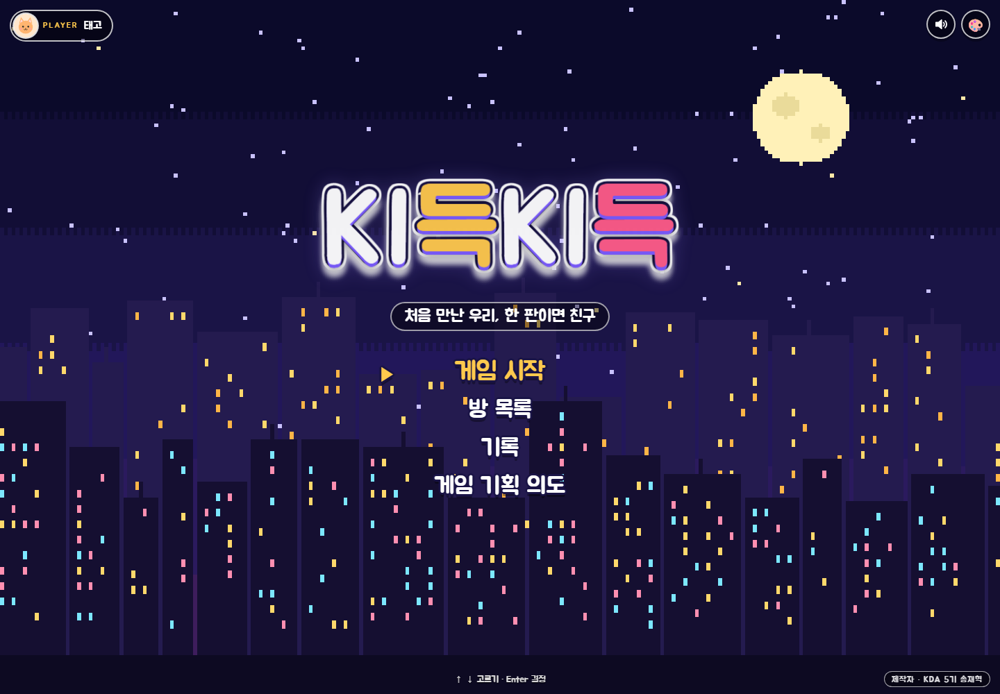
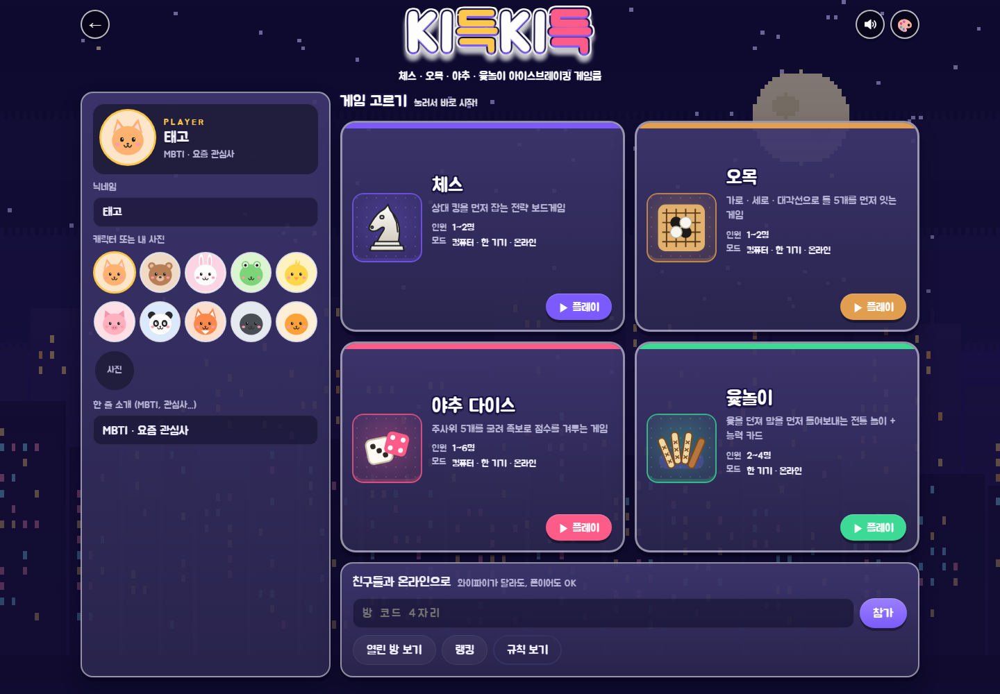
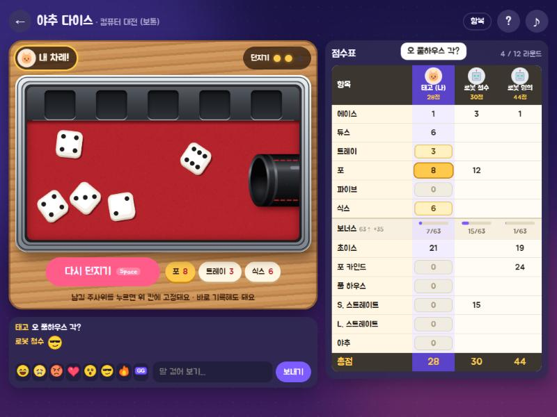
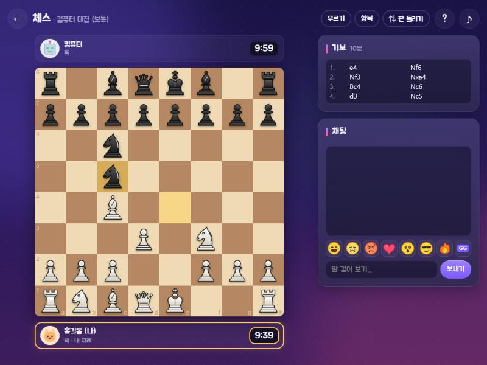
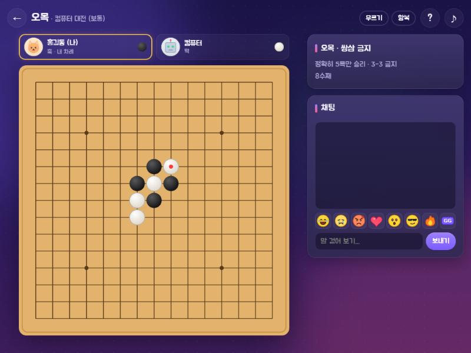
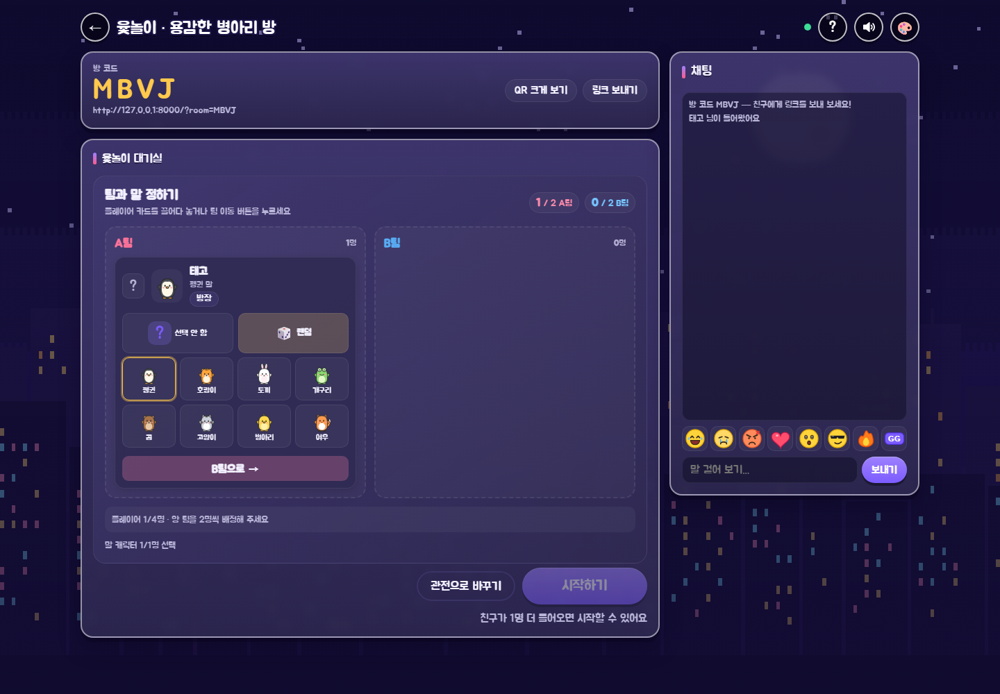
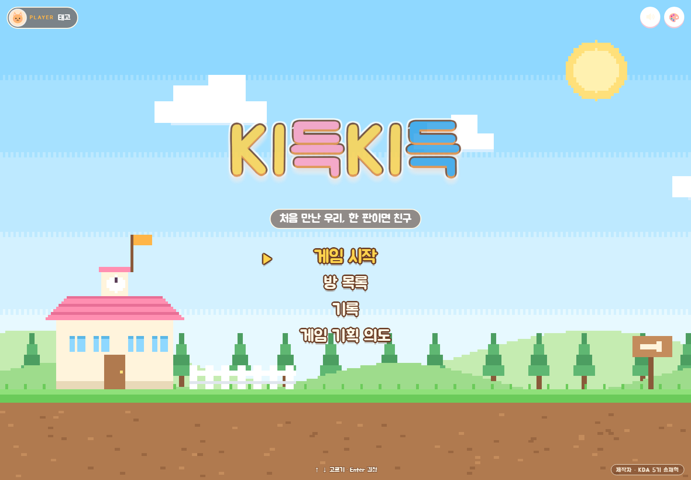
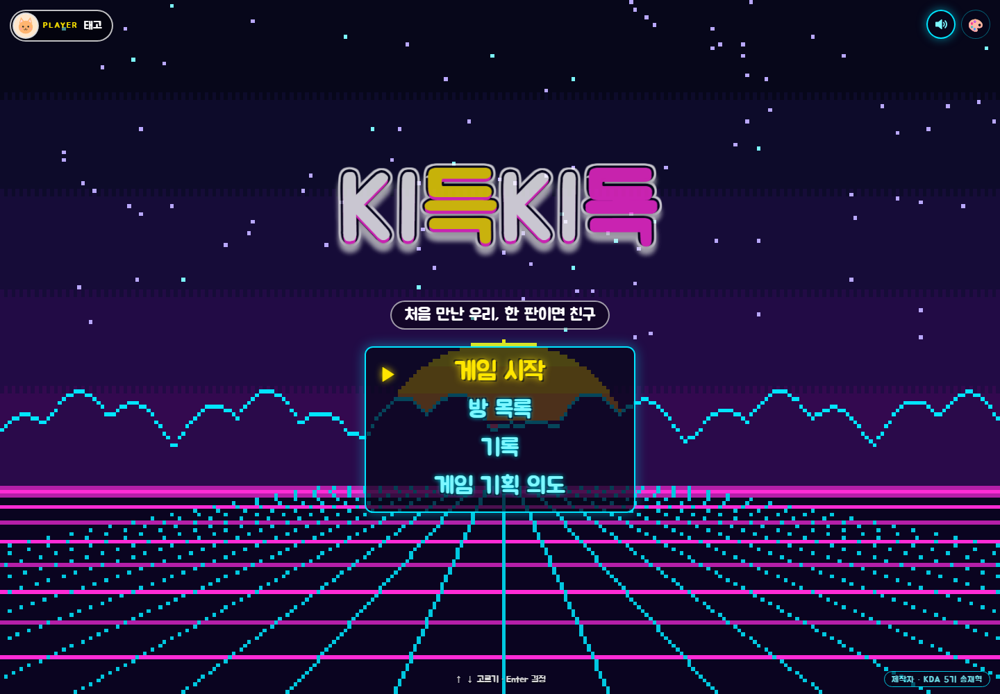
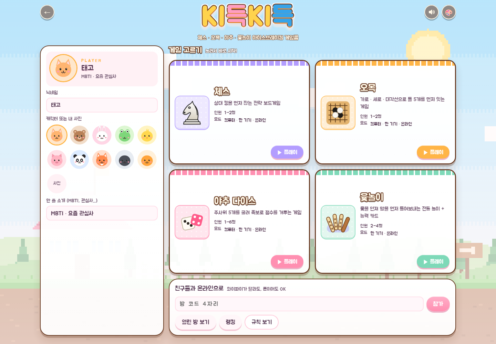
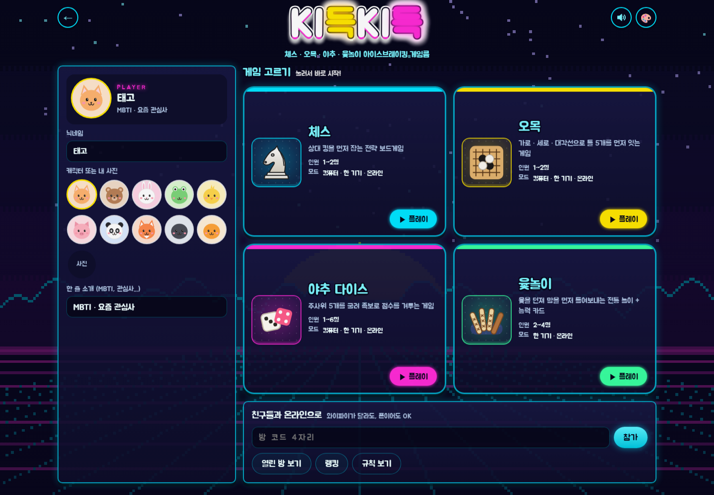

# KI득KI득 🎲

> 처음 만난 우리, 한 판이면 친구 — 새 기수의 어색함을 깨는 아이스브레이킹 미니게임룸

[](https://github.com/devtaego/PJ_KDKD/actions/workflows/test.yml)

KDA(키움 산하 교육기관) 새 기수가 처음 만났을 때 어색함 없이 친해질 수 있도록 만든 **체스 · 야추 다이스 · 오목 · 윷놀이** 게임룸이에요.
게임 자체보다 **어색함을 깨고 빨리 친해질 대화의 계기**를 만드는 게 목표예요. 함께 플레이하고 채팅 · 스티커로 응원한 뒤, 게임이 끝나면 패자가 받은 질문 카드로 서로 MBTI · 취미 · 첫인상 · 관심사를 묻고 답해요.

- **웹판 (v2)**: 브라우저만 있으면 노트북 · 폰 어디서나, 와이파이가 달라도 같이 해요 → **https://kidk-web.onrender.com**
- **데스크톱판 (v1)**: exe 하나로 같은 와이파이 안에서 해요.
- 만든 사람: **KDA 5기 송재혁** · 개발 과정과 고민: [DEVLOG.md](DEVLOG.md)

<p align="center"></p>

<table>
  <tr>
    <td width="50%"></td>
    <td width="50%"></td>
  </tr>
  <tr>
    <td align="center">게임 고르기 — 네 게임과 플레이어 프로필</td>
    <td align="center">야추 다이스 — 컵을 흔들어 던지고, 항목 이름을 누르면 예시 주사위 설명</td>
  </tr>
  <tr>
    <td></td>
    <td></td>
  </tr>
  <tr>
    <td align="center">체스 — 기물을 누르면 갈 수 있는 칸 표시, 시간 모드</td>
    <td align="center">오목 — 쌍삼 금지 / 자유룰, 컴퓨터 난이도 3단계</td>
  </tr>
  <tr>
    <td></td>
    <td></td>
  </tr>
  <tr>
    <td align="center">윷놀이 대기실 — 캐릭터를 미리 고르고 A · B팀을 배정</td>
    <td align="center">결과 — 티배깅 연출과 모두가 대화하는 질문 카드</td>
  </tr>
</table>

---

## 이렇게 놀아요

| 하고 싶은 것 | 방법 |
| --- | --- |
| 혼자 연습 | **컴퓨터 대전** (쉬움 / 보통 / 어려움) |
| 옆자리 친구와 한 기기로 | **한 기기에서 같이** (체스 · 오목 2명, 야추 최대 6명, 윷놀이 2~4명) |
| 각자 폰 · 노트북으로 | **온라인** → 방 만들기 → 4자리 코드나 링크를 단톡방에 공유 |
| 사람이 많을 때 | 꽉 찬 방에 들어가면 **대기 줄**에 서요. 진 사람은 줄 맨 뒤로, 이긴 사람은 계속 — **연승**이 쌓여요 |
| 모르는 사람 없이 우리끼리 | 방을 **비공개**로 만들면 목록에 안 보이고 코드로만 들어와요. 이상한 사람은 방장이 **내보내기** |
| 교실에서 한 번에 | 대기실의 **QR 크게 보기**를 빔프로젝터에 띄우면 다들 폰 카메라로 찍고 바로 들어와요 |
| 분위기 바꾸기 | 화면 오른쪽 위 **팔레트 버튼**을 눌러 미리보기와 함께 밤하늘 · 말랑말랑 · 오락실 테마 선택 |
| 누가 제일 잘하나 | **랭킹**: 이 기기 기록 + 우리 반(온라인) 기록 |

### 게임

- **체스**: 캐슬링 · 앙파상 · 승진, 시간 모드(무제한 / 10분 / 3분+2초), 기보(SAN), 판 돌리기
- **야추 다이스**: 컵을 꾹 눌러 흔들다 놓으면(키보드는 스페이스바) 주사위가 쏟아져 튕기고 구르다 멈춰요. 오래 흔들수록 세게 던져져요. 남길 주사위를 누르면 위 칸으로 올라가 고정되고, 멈추면 **추천 칸 3개**가 떠요. 점수표 항목 이름을 누르면(마우스는 올리면) 설명과 **예시 주사위**, "지금 기록하면 몇 점"이 말풍선으로 나와요
- **윷놀이** (2~4명, 각자 말 2~4개): 방을 만들면 별도 대기실에서 팀과 말 캐릭터를 미리 정해요. 캐릭터는 통통한 동물 8종(펭귄 · 호랑이 · 토끼 · 개구리 · 곰 · 고양이 · 병아리 · 여우) 중에서 고르고, 선택 없음과 랜덤을 구분해 보여 줘요. 팀전에서는 플레이어를 드래그해 팀을 옮길 수 있어요. 모두 준비된 뒤 게임을 시작하면 카드 추첨 연출을 거쳐 플레이해요.
  - 위에서 내려다본 정사각형 윷판에서 윷가락을 던져요(스페이스바). 결과가 정해지는 순간 이동 경로를 미리 노출하지 않고, 윷가락 애니메이션이 끝난 뒤 결과를 보여 줘요. 말을 고르면 이동 경로를 확인하고 선택해 이동하며, 새 말을 꺼낼 때는 카드에서 사라져 출발점에서 곧바로 이동을 시작해요. 도·빽도는 뒤로 움직이고, 도·빽도로 출발점에 돌아오면 골인해요. 특수 능력에 의한 후퇴는 골인 처리가 되지 않고 이동 중 상대 말을 잡을 수 있어요. 빨간 화살표는 바깥 길, 파란 화살표는 지름길이에요.
  - **2:2 팀전**(4명): 대기실에서 방장이 A팀 · B팀을 2명씩 나눠요 (차례는 두 팀이 번갈아). 같은 팀 말은 업혀서 같이 가고 서로 안 잡아요. 내 말이 다 들어오면 같은 팀 말을 대신 옮기고, 두 사람 말이 다 들어온 팀이 이겨요
  - 모드: **기본**(능력 없음) · **특수능력**(시작할 때 능력 카드 3장) · **막장**(4장 + 전설 카드). 한 차례에 한 장씩 써요
  - 카드 18종: 킹받쥬 · 럭키비키 · 갓생 모드 · 이게 맞아? · 가즈아 · 스불재 폭탄 · 어쩔티비 … 전설은 대환장 파티(말 위치 섞기) · 전원 집합 · 러시안 윷렛 · 도파민 중독
  - 게임 화면의 **확률표**에서 윷 결과 · 카드별 확률을 볼 수 있어요. 윷 결과는 확률 가중치로 정하고, 애니메이션이 끝난 다음 같은 결과를 게임 규칙에 반영해요
  - 카드 이름 · 대사 · 확률은 [`yut_abilities.js`](web/static/js/data/yut_abilities.js) 한 파일에 모여 있어서 다음 기수 유행어로 바꿔 끼우기 쉬워요
- **오목**: 정확히 5목만 승리(장목 불인정) + 쌍삼 금지 / 자유룰, 금지 자리는 빨간 ×로 표시, 폰은 한 번 눌러 미리 보기 → 한 번 더 눌러 놓기

### 아이스브레이킹 장치

- **프로필**: 직접 그린 동물 캐릭터 8종 또는 내 사진 + **한 줄 소개**(MBTI, 관심사…)
- **채팅과 스티커**: 스티커 8종이 보낸 사람 머리 위에 잠깐 떠요
- **결과 화면**: 상황별 멘트와 왕관이 프로필과 함께 움직이는 **티배깅**, 착지 반동 · 흔들림 · 타격 문구. 패자가 받는 **대화 질문 카드**는 MBTI · 취미 · 여행 · 첫인상 · 관심사 등 가벼운 주제로 서로 묻고 답할 수 있어요. 온라인 참가자에게 같은 질문이 표시돼요
- **연승**: 같은 방에서 2연승부터 이름 옆에 "3연승" 배지 + 모두에게 알림

### 타이틀 화면과 테마

게임을 켜면 픽셀 아트 장면 위에 큰 로고와 메뉴가 뜨는 **타이틀 화면**이 먼저 나와요. 마우스 · 터치로 고르거나, 키보드 ↑ ↓ 로 ▶ 커서를 옮기고 Enter를 눌러요. 소리 옆 🎨 팔레트 버튼을 누르면 예시가 있는 테마 선택 창이 열려요.
밤하늘 · 말랑말랑 · 오락실 장면은 테마마다 다르고 모두 코드로 직접 그렸어요 (작게 그려서 크게 늘린 도트). 고른 테마는 게임 선택 화면과 대기실에도 이어져요.

<table>
  <tr>
    <td width="50%"></td>
    <td width="50%"></td>
  </tr>
  <tr>
    <td align="center">말랑말랑 — 구름이 흘러가는 언덕 위 학교, 동화책 같은 노란 로고</td>
    <td align="center">오락실 — 줄무늬 네온 해와 앞으로 달려오는 격자 바닥</td>
  </tr>
  <tr>
    <td></td>
    <td></td>
  </tr>
</table>

타이틀 다음 화면(게임 고르기 · 방 · 게임)도 같은 픽셀 장면을 은은하게 깔고, 판은 타이틀 이름표처럼 굵은 테두리, 제목은 타이틀 메뉴 같은 테두리 글씨로 맞췄어요.
효과음은 어느 화면이든 **오른쪽 위 스피커 버튼**으로 켜고 꺼요.
고른 테마는 이 기기에 저장돼요. 게임판 · 주사위 트레이 · 점수표는 어느 테마에서도 같은 모습이에요.

### 온라인에서 안심하고

- 새로고침하거나 잠깐 끊겨도 **30초 안에** 돌아오면 하던 판 그대로 (시계까지). 기다리는 쪽에는 "N초 안에 안 오면 기권"이 보여요
- 야추 중에 연결이 끊기면 6초 뒤 **컴퓨터가 대신** 둬 줘요 (다시 들어오면 바로 돌려받음)
- **주사위는 서버가 굴려요** — 브라우저 코드를 고쳐도 원하는 눈을 낼 수 없어요
- 무르기는 상대가 수락해야 되고, 사람끼리는 한 판에 2번까지
- 채팅 · 효과 도배는 서버가 자동으로 걸러요

---

## 바로 시작하기

### 웹 (추천)

**https://kidk-web.onrender.com** 에 접속하면 끝이에요. 설치도 계정도 필요 없어요.

- 폰에서는 브라우저 메뉴의 **홈 화면에 추가**를 누르면 앱처럼 쓸 수 있어요.
- 친구 초대는 대기실의 **링크 보내기**(단톡방) 또는 **QR 크게 보기**(교실 화면).
- 데스크톱판 첫 화면의 **웹판** 버튼으로도 열 수 있어요.

### 데스크톱판 (같은 와이파이 전용)

`release` 폴더에 있어요.

| 파일 | 설명 |
| --- | --- |
| `release/windows/KI득KI득.exe` | **추천** — 게임 3종이 모두 들어 있는 게임룸 |
| `release/windows/Chess.exe`, `Yacht.exe`, `Omok.exe` | 게임 하나만 따로 실행 |
| `release/mac/KI득KI득_mac.zip` | 맥용 (압축을 풀고 `KI득KI득 실행.command` 더블클릭) |

- **Windows**: SmartScreen 경고가 뜨면 `추가 정보 → 실행`, 방화벽 창이 뜨면 **개인 네트워크 허용**
- **Mac**: Python 3이 필요해요. '확인되지 않은 개발자' 경고가 뜨면 우클릭 → 열기
- 같이 하기: 모두 같은 와이파이에서 한 사람이 **네트워크 → 방 만들기**, 나머지는 **참가하기**에서 열린 방을 눌러요
  (UDP 50010으로 방을 찾고, 게임은 TCP 50007 체스 · 50008 야추 · 50009 오목)

---

## 서버 운영 (웹판)

### 내 PC에서 켜기

```bash
pip install -r web/requirements.txt
python web/server.py
```

`http://localhost:8000` 으로 접속해요. 같은 와이파이의 폰은 `http://<내 PC IP>:8000`.

### Render에 무료로 올리기

1. [render.com](https://render.com)에 GitHub 계정으로 로그인
2. **New → Blueprint** → 이 저장소 선택 → **Apply** (저장소의 `render.yaml`을 읽어서 자동 설정)
3. 몇 분 뒤 `https://<서비스 이름>.onrender.com` 주소가 생기면 끝. main에 push하면 자동으로 다시 배포돼요

> **무료 플랜 메모**
> - 15분 동안 아무도 안 들어오면 잠들고, 첫 접속은 30초쯤 걸려요.
> - 무료 사용 시간(한 달 750시간)은 계정 전체가 함께 써요. 잠든 시간은 세지 않아요.
> - 카드를 등록하지 않으면 과금될 일이 없어요. 한도를 넘으면 돈이 나가는 게 아니라 서버가 멈춰요.
> - 수업 시간에 깨어 있게 하려면 [UptimeRobot](https://uptimerobot.com) 같은 무료 서비스로 `/healthz`를 5~10분마다 부르게 하세요. 24시간 내내 돌리면 다른 프로젝트 몫의 시간까지 다 써요.
> - 탭을 열어 둔 채 자리를 비워도 서버가 계속 깨어 있지 않도록, 아무것도 안 한 연결은 서버가 끊어요(대기 화면 20분, 방 안 45분). 다시 화면을 누르면 자동으로 이어져요.
> - **수업 중에는 main에 push하지 마세요.** 방과 진행 중인 판은 서버 메모리에만 있어서, 다시 배포되면 모두 끊겨요.

### 우리 반 랭킹을 계속 남기기 (Supabase)

Render 무료 서버는 다시 켜질 때마다 파일이 지워져서, 그냥 두면 우리 반 랭킹이 초기화돼요.
무료 [Supabase](https://supabase.com) 데이터베이스를 연결하면 계속 남아요.

1. Supabase에서 새 프로젝트를 만들어요.
2. **SQL Editor**에 [`supabase/schema.sql`](supabase/schema.sql)을 붙여 넣고 **Run** (랭킹 표 + 결과를 더하는 함수가 생겨요)
3. **Project Settings → API**에서 `Project URL`과 `service_role` 키를 복사해요.
   이미 예전 `schema.sql`로 만들어 둔 표라면, 파일 위쪽의 **"이미 예전 버전으로 표를 만들었다면"** 두 줄(`alter table … kidk_ranking_game_check`)만 한 번 더 Run 하면 윷놀이 기록도 저장돼요.
4. Render 서비스의 **Environment → Edit**에서 두 값을 넣고 저장 → 자동으로 다시 배포돼요.
   (`render.yaml`에 이 두 이름이 `sync: false`로 적혀 있어서 Blueprint를 다시 맞춰도 값이 지워지지 않아요)

| 이름 | 값 |
| --- | --- |
| `SUPABASE_URL` | `https://xxxx.supabase.co` |
| `SUPABASE_SERVICE_KEY` | `service_role` 키 |

> `service_role` 키는 **절대 저장소나 채팅에 올리지 마세요.** Render 환경 변수에만 넣어요.
> 랭킹 표는 RLS로 막혀 있어서 브라우저용 키로는 읽기도 쓰기도 못 하고, 서버만 접근해요.
> 두 값이 없으면 서버는 예전처럼 `web/ranking.json` 파일에 저장해요.

---

## 개발

### 폴더 구조

```
web/                 웹 · 모바일판
  server.py            웹 서버: 화면 보내기 + 웹소켓(방 · 대기 줄 · 연승 · 채팅 · 수 전달 · 내보내기 · 도배 막기) + 방 QR
  ranking_store.py     우리 반 랭킹 저장 (Supabase 또는 파일)
  static/              브라우저 화면
    js/engine/           규칙 엔진 (파이썬판을 그대로 옮김)
    js/games/            체스 · 오목 · 야추 · 윷놀이 화면, 주사위 트레이 물리, 윷놀이 말 캐릭터
    js/data/             윷놀이 능력 카드 목록과 확률
    sounds/              윷 던지는 소리 (출처는 '사용한 오픈소스' 아래 표)
    js/app.js            첫 화면 · 방 목록 · 대기실 · 랭킹
    js/theme.js          테마 (밤하늘 · 말랑말랑 · 오락실)
    js/scene.js          타이틀 화면 픽셀 아트 장면 (테마마다)
    js/match.js          한 판 진행 틀 (컴퓨터 · 한 기기 · 온라인을 같은 방식으로)
  tests/               자바스크립트 규칙 엔진 테스트 (Node)
supabase/schema.sql  랭킹 표와 함수
render.yaml          Render 배포 설정
hub/ chess/ yacht/ omok/   데스크톱판 (tkinter)
tests/               파이썬 테스트 (데스크톱 규칙 엔진 + 웹 서버)
docs/images/         README 스크린샷
fonts/               주아체 (SIL OFL)
release/             데스크톱판 exe와 맥용 zip
```

### 테스트

```bash
python -m unittest discover -s tests -v
```

```bash
node --test web/tests/engines.test.mjs
```

- **파이썬 35개**: 체스 perft · 체크메이트 · 오목 장목 · 쌍삼 · 야추 점수 · 질문 카드, 웹 서버의 방 · 관전 · 재접속 · 비공개 방 · 서버 주사위 · 윷놀이 seed · 끊긴 사람 대신 두기 · 대기 줄과 연승 · 내보내기 · 랭킹 조작 막기 · 도배 막기, 보안(비밀 열쇠 숨기기 · 크기 제한 · 접속 수 제한 · 다른 사이트 차단 · 보안 헤더 · QR) · 비용(사진 한 번만 보내기 · 오래 쉰 연결 끊기), 가짜 Supabase로 저장소 확인
- **자바스크립트 20개**: 웹판 규칙 엔진이 파이썬판과 같은 결과를 내는지 (perft 8902, 질문 카드 crc32까지), 윷놀이 지름길 · 잡기 · 업기 · 빽도(윷 + 빽도 포함) · 능력 · 시작 카드 · 2:2 팀전, 같은 seed면 같은 판인지 (4명이 아무렇게나 끝까지 둬 보기)
- GitHub에 push하면 [GitHub Actions](.github/workflows/test.yml)가 두 테스트를 자동으로 돌려요

### 데스크톱 exe 만들기

```bash
pip install pillow pyinstaller
pyinstaller --onefile --windowed --name KI득KI득 ^
  --paths chess --paths yacht --paths omok --paths hub ^
  --hidden-import avatars --hidden-import party --hidden-import chat --hidden-import ui_kit ^
  --hidden-import lan --hidden-import sound ^
  --add-data "fonts;fonts" hub/game_room.py
python hub/make_mac_zip.py
```

깨끗한 가상환경에서 빌드해야 exe가 약 21MB로 작게 나와요.

---

## 개인정보와 보안

- 계정 · 비밀번호 · 결제 정보가 없어요. 닉네임, 한 줄 소개, 프로필 사진(96px, 약 60KB 이하)만 방에 있는 사람에게 전달되고 서버에 저장하지 않아요.
- 채팅과 수는 진행 중인 방에만 잠깐 두고 따로 저장하지 않아요. https 주소면 주고받는 내용은 암호화돼요.
- 우리 반 랭킹에는 닉네임과 승 · 판 수만 저장돼요. 결과는 판을 시작할 때 앉아 있던 사람 이름만 받아요.
- 브라우저마다 **비밀 열쇠**를 갖고, 다른 사람에게는 **공개 번호**만 보여요. 같은 방 사람이 남의 자리를 가로챌 수 없어요.
- 판에 앉는 사람 목록과 주사위는 서버가 정해요. 게임 수 · 효과는 크기와 종류를 검사하고, 채팅 · 효과 도배와 한 주소의 과도한 접속(기본 60개, 학교 와이파이는 반 전체가 같은 주소라 넉넉하게)은 서버가 막아요.
- 다른 웹사이트가 몰래 서버에 연결하지 못하게 하고, 보안 헤더(CSP · 클릭재킹 차단 등)를 붙였어요.
- 채팅 · 닉네임은 화면에 글자로만 그려서 코드가 실행되지 않아요(XSS 방지).

## 사용한 오픈소스

| 이름 | 라이선스 | 쓰임 |
| --- | --- | --- |
| Python | PSF License | 프로그램 언어 |
| Tcl/Tk (tkinter) | BSD 스타일 | 데스크톱판 화면 |
| Pillow | MIT-CMU (HPND) | 데스크톱판 그림 그리기 |
| aiohttp | Apache 2.0 | 웹판 서버 (웹소켓) |
| qrcode | BSD | 방 링크 QR 코드 |
| PyInstaller | GPL 2.0 + 배포 예외 | exe 만들기 (만든 프로그램은 자유롭게 배포 가능) |
| 주아체 (Jua) | SIL Open Font License 1.1 | 글꼴 (`fonts/Jua-OFL.txt`) |

게임 규칙은 전통 게임 규칙이고, 기물 · 주사위 · 캐릭터 · 윷판 · 윷가락 · 스티커 · 효과는 모두 코드로 직접 그렸어요.

| 소리 | 출처 | 쓰임 |
| --- | --- | --- |
| 윷 던지는 소리 (`web/static/sounds/yut1~5.wav`) | YouTube 「[무료효과음] 프로가 직접 만드는 윷놀이 소리 SoundEffects / Yutnori」 https://www.youtube.com/watch?v=rLSAQLD6xos | 윷놀이에서 윷가락이 떨어질 때 (영상의 소리 5개를 잘라 씀, 게임 안 '정보' 창에도 출처 표시) |

나머지 효과음은 소리 파일 없이 코드(Web Audio)로 만들었어요.
